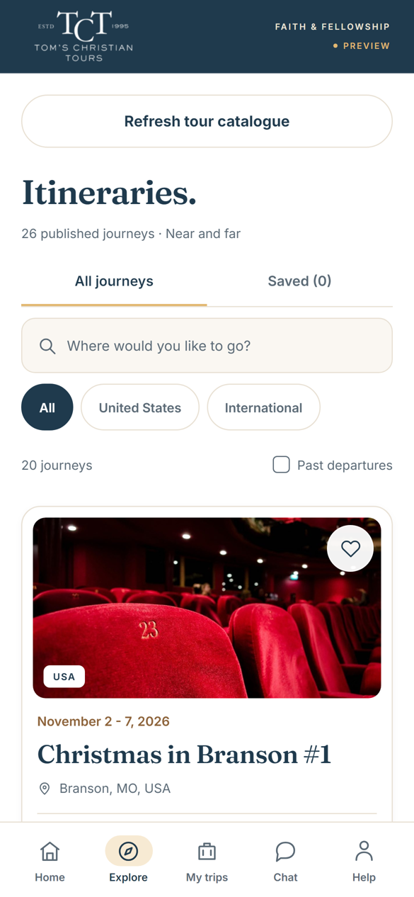
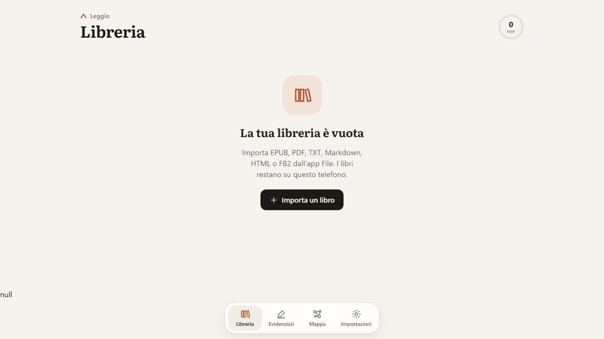
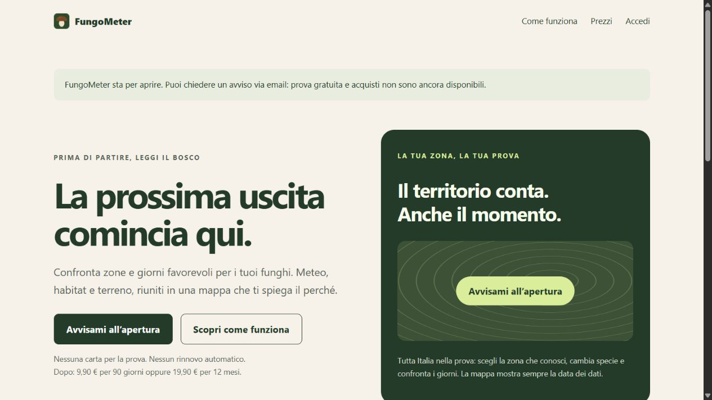

# Applicazioni web e mobile

**Francesco Chiarolanza · Roma**  
TypeScript, React, Node.js e Python, dalle interfacce alle API e ai dati.

Stato dei link verificato il **27 ottobre 2026**. Le indicazioni qui sotto distinguono ciò che si può provare pubblicamente dalle funzioni del progetto completo.

| Progetto | Cosa vedere | Tecnologie |
|---|---|---|
| Tom’s Christian Tours | Schermate del catalogo, della ricerca e delle schede viaggio. Accesso riservato al cliente | React Native / Expo, TypeScript; backend del progetto Node.js e SQLite |
| [Leggio](https://framik02.github.io/leggio/) | Libreria e lettore PWA utilizzabili nel browser | JavaScript, IndexedDB, Service Worker, Web Speech API |
| [FungoMeter](https://fungometer.chiarolanza-francesco.workers.dev/) | Sito del prodotto in preapertura; codice e metodo pubblici | Python, JavaScript, Leaflet, API meteo, GitHub Actions |

## Tom’s Christian Tours

App per un tour operator statunitense, con frontend condiviso web/mobile e servizio Node.js con persistenza SQLite. Il progetto comprende catalogo, area viaggiatori, chat per partenza e console staff, con ruoli e autorizzazioni controllati dal server. Integrazione WeTravel in sola lettura e ambiente demo distinto dai servizi reali.

L'app è sviluppata per il cliente e l'accesso resta riservato. Le schermate qui sopra mostrano home, catalogo con ricerca e filtri e scheda di un viaggio. Posso mostrare il resto, area viaggiatori e console staff comprese, durante un colloquio.

## Leggio

PWA per importare e leggere EPUB, PDF con testo, TXT, Markdown, HTML e FB2. Ho implementato lettore personalizzabile, evidenziature, note e ascolto tramite le voci del dispositivo. Libri e progressi sono conservati in IndexedDB; il service worker permette l’uso offline.

**Da provare:** [apri Leggio](https://framik02.github.io/leggio/), importa un breve file di prova, modifica la tipografia e prova ricerca e ascolto. I libri con DRM non sono supportati; per i PDF scansionati serve OCR.

[Codice sorgente](https://github.com/framik02/leggio)

## FungoMeter

Pipeline Python che acquisisce dati meteo e territoriali e calcola indici delle condizioni ambientali. Frontend cartografico JavaScript/Leaflet, test pytest sul motore e workflow GitHub Actions per l’aggiornamento. Preparazione geografica, scoring e interfaccia sono componenti separati.

**Stato pubblico:** il [sito](https://fungometer.chiarolanza-francesco.workers.dev/) è in preapertura; la prova della mappa e gli acquisti non sono ancora disponibili. Si possono consultare la presentazione e il metodo, oltre al [codice pubblico](https://github.com/framik02/fungometer). Il punteggio non garantisce ritrovamenti e non identifica funghi; risoluzione delle celle e del meteo sono distinte.

---
[Torna al portfolio dati e NLP](../README.md)
