> Analisi di data journalism sul dibattito online attorno al caso Roggero.
> Corpus di 144.970 commenti YouTube su 1.036 video, dal 2021 al 2026, classificati con un modello BERT italiano addestrato per l'occasione.

# Caso Roggero

Era il **28 aprile 2021** quando il gioielliere **Mario Roggero** freddava con una revolver, in mezzo alla strada, due dei tre rapinatori che avevano appena rubato nella sua gioielleria.

A dicembre 2023 la Corte d'Assise di Asti condanna Roggero a **17 anni** di reclusione per duplice omicidio volontario, tentato omicidio e porto abusivo d'armi. Successivamente la Corte d'Assise d'Appello di Torino conferma l'impianto accusatorio, riducendo però la pena a **14 anni e 9 mesi**. Il **15 luglio 2026** la Suprema Corte respinge i ricorsi della difesa, confermando in via definitiva la sentenza di appello a 14 anni e 9 mesi di carcere.

Negli ultimi giorni questa sentenza ha fatto esplodere l'opinione pubblica, e chiunque, online e dal vivo, era pronto ad avere un'opinione al riguardo. La politica non si è fatta cogliere impreparata e ha colto al volo l'opportunità per strumentalizzare l'onda emotiva e utilizzarla come veicolo della propria propaganda.

A destra apre **Matteo Salvini**, che chiede la grazia, va a trovare Roggero in carcere a Bollate, non esclude nemmeno di candidarlo, e liquida ogni polemica assicurando che la decisione "possa essere presa in considerazione liberamente, nei tempi e nei modi che vorrà, dal presidente della Repubblica". **Roberto Vannacci** rincara la dose, senza sfumature, sostenendo che "il concetto è semplice: se io sono a casa mia, se sono per la strada e qualcuno mi aggredisce, la difesa deve essere sempre legittima", e si concede pure la battuta "se fossi il presidente della Repubblica ci penserei". **Giorgia Meloni** chiude il cerchio con una frase destinata a diventare slogan, "chi commette reati non può essere risarcito". A stonare in questo coro è Forza Italia. **Antonio Tajani** ammette che Roggero "ha sbagliato" ed è "colpevole", si dice pronto a un atto di clemenza per una "reazione sproporzionata", ma frena su ogni riforma della norma, "non siamo per il Far West o la giustizia privata".

A sinistra la risposta non si fa attendere, e usa lo stesso registro ribaltato. **Giuseppe Conte** accusa il centrodestra di fare "a gara a chi primeggia nello sciacallaggio sul caso del gioielliere" e avverte che, se passasse la riforma proposta dalla Lega, "non esisterebbe più la legittima difesa, esisterebbe il diritto di realizzare una vendetta". **Chiara Braga**, capogruppo PD alla Camera, punta dritta alla scena della visita in carcere di Salvini, bollandola come "l'apice di una spettacolarizzazione della giustizia". Da Avs a +Europa il principio ripetuto è sempre lo stesso, "le sentenze si rispettano", e trasformarle in propaganda è un pericolo per lo Stato di diritto. Anche il centro non sta a guardare. **Carlo Calenda** chiude con una riga che farà notizia, "in Italia girano troppe pistole, non vogliamo vivere nel Far West".

Abbiamo visto una rassegna delle posizioni dei maggiori leader politici, ma cosa ne pensano invece i cittadini?

Per rispondere a questa domanda ho analizzato i commenti YouTube sotto i video che trattavano del caso Roggero a partire dal 28 aprile 2021 fino ad oggi.

## I numeri del dibattito

Dall'avvenimento del misfatto ad oggi sull'argomento sono stati pubblicati **1.036 video** e scritti **144.970 commenti** da **58.719 persone diverse**.

La prima cosa da notare è che l'**82,3% del dibattito pubblico si è concentrato nel solo luglio 2026** (119.349 commenti su 144.970), e in particolare il **79,6% è arrivato negli ultimi 6 giorni**, da quando il **15 luglio** la Cassazione ha reso definitiva la condanna. Prima della sentenza definitiva il caso aveva un ruolo marginale nell'opinione pubblica, appena il **3,1%** dei commenti (4.490 su 144.970) si era accumulato nei due anni e mezzo che separano il fatto di sangue dell'aprile 2021 dalla prima condanna del dicembre 2023, che a sua volta aveva generato un picco isolato (**11.717 commenti** in un solo mese) prima di tornare a un flusso marginale fino all'esplosione di luglio 2026.

Di seguito il grafico con il volume dei commenti nel tempo.

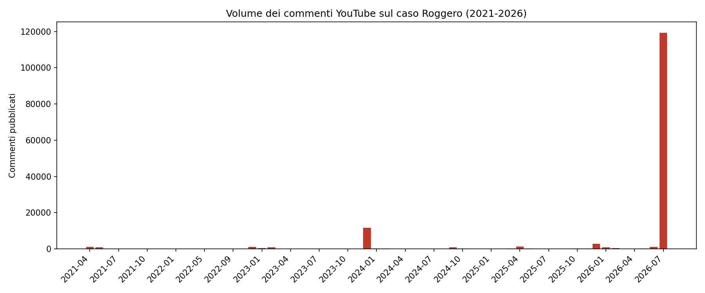

### Due picchi a confronto, la prima condanna (2023) e la condanna definitiva (2026)

Guardando il grafico, oltre all'esplosione di luglio 2026 c'è un solo altro momento in cui il dibattito si è acceso in modo significativo, la settimana tra il **4 e il 18 dicembre 2023**, quando la Corte d'Assise di Asti pronuncia la prima condanna (17 anni). In quelle due settimane si concentrano **11.131 commenti**, il **7,7% dell'intero corpus** raccolto in oltre cinque anni, un picco vero ma di dimensioni molto più contenute. La finestra del 15-20 luglio 2026 (114.396 commenti, il **78,9% del corpus**) è **10,3 volte più ampia**.

Più della dimensione, colpisce la **stance**, rimasta quasi identica a distanza di due anni e mezzo nonostante un pubblico enormemente più ampio.

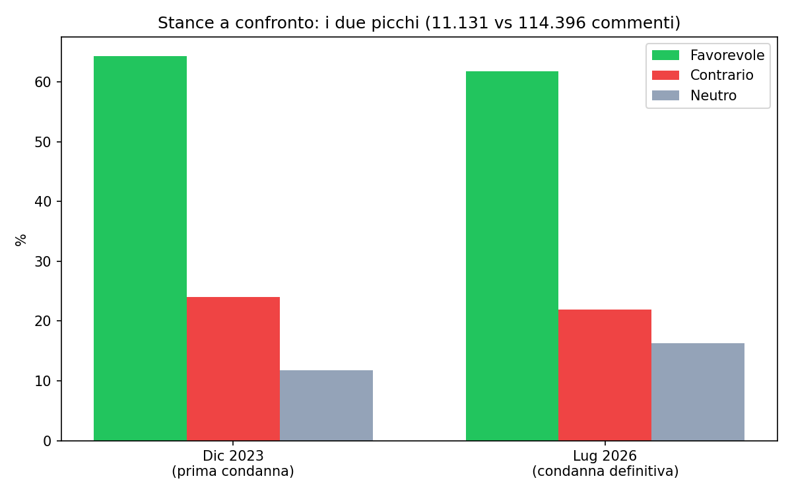

Lo scarto tra i due momenti resta contenuto (**2-5 punti percentuali**), a fronte di un pubblico oltre dieci volte più grande. L'esplosione di luglio ha portato allo scoperto un giudizio già cristallizzato dal 2023, più che averlo radicalizzato o ribaltato con l'intervento dei leader politici nell'estate 2026. Il movimento più marcato è un aumento della quota di commenti neutri (**+4,5 punti**), coerente con un pubblico più ampio e meno "militante" attratto dalla risonanza mediatica della sentenza definitiva.

### Il raffreddamento nella settimana calda

Guardando dentro la finestra del **15-20 luglio** giorno per giorno, il clima parte altissimo e si raffredda in modo netto e quasi monotono man mano che il dibattito matura.

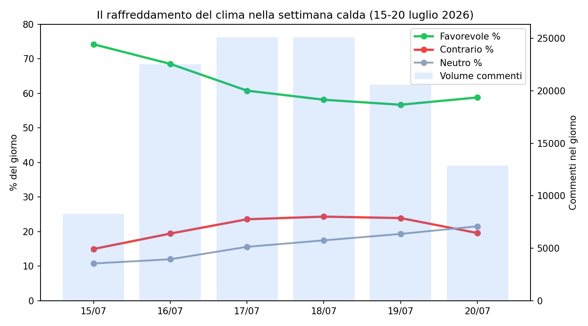

Il dettaglio ora per ora rende ancora più visibile la dinamica. Il volume sale a picchi nelle ore diurne/serali, con un massimo di **1.921 commenti** tra le 18:00 e le 19:00 del **17 luglio**, e cala nelle ore notturne, in un pattern che si ripete identico giorno dopo giorno.

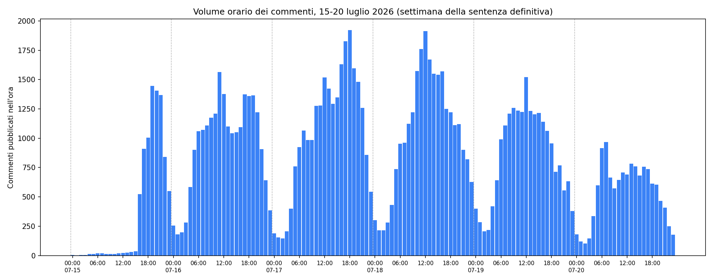

Nelle primissime ore dopo l'annuncio (15/7, 11:00-15:00, prima che il volume esploda davvero) la reazione a caldo è quasi plebiscitaria, **98 favorevole contro 19 contrario**. Da lì il clima scende di quasi **27 punti** in cinque giorni, toccando il minimo di **+32,8** il 19 luglio, un pattern coerente con una dinamica tipica delle notizie shock, la prima ondata è emotiva e quasi unanime, e via via che il pubblico si allarga entrano in gioco più voci critiche e argomentate. Il **20 luglio** il clima risale leggermente a **+39,2**, un dato ora completo e non più parziale rispetto alla prima versione di questa analisi: il raffreddamento non prosegue in modo indefinito, si ferma dopo cinque giorni e lascia spazio a un lieve rimbalzo. Il ritardo iniziale della fase critica è coerente con la scoperta successiva che i commenti contrari sono mediamente più lunghi e articolati, quindi più lenti a comparire rispetto alla reazione istintiva favorevole (si veda sotto).

## Favorevoli e contrari

Entrando nel succo dell'analisi, andiamo a vedere concretamente quante persone si sono schierate a favore del gioielliere e quante invece gli si sono scagliate contro. I commenti totali favorevoli a Roggero sono **90.842**, mentre quelli contrari sono **31.485**, rispettivamente il **62,7%** e il **21,7%** del totale, contando che i neutri si attestano al **15,6%**.

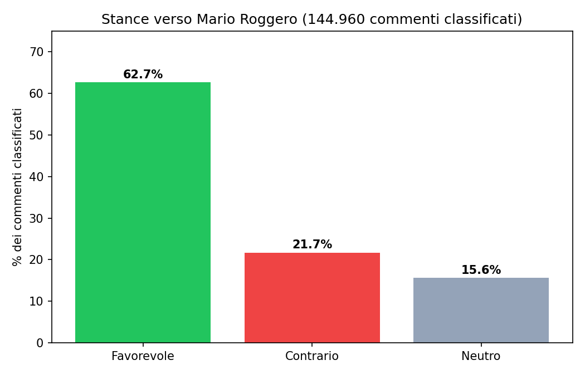

Scavando più a fondo possiamo vedere come si sono distribuiti nel tempo, il vantaggio dei favorevoli è **un rapporto di forze stabile dall'inizio della vicenda**, non un artefatto dell'ondata più recente.

L'arena mediatica scagiona in modo quasi unanime Roggero. Provando a contare solo un commento per utente invece dei commenti totali, il quadro resta identico. Deduplicando i commenti il risultato è confermato, sempre una sconfitta schiacciante per chi pensa che Roggero meriti il carcere (favorevoli al **67,6%**, contrari al **19,6%**, neutri al **12,9%** su **58.716 utenti unici**). Questo permette anche di misurare la sproporzione di commenti scritti dagli utenti delle due fazioni. I sostenitori del gioielliere commentano in media il **5% in meno** rispetto ai contrari (2,51 commenti a testa contro 2,64). Il divario si è ridotto rispetto alla prima rilevazione su questo corpus (era il **12%**): con più dati la differenza di prolificità tra le due fazioni resta reale ma più contenuta di quanto sembrasse su un campione più piccolo. Chi contesta la sentenza resta comunque meno numeroso e relativamente più insistente nel ripetere la propria posizione.

### Le parole più polarizzanti

Ho isolato, tra le parole e le frasi più frequenti del corpus, quelle con la stance più sbilanciata da una parte o dall'altra, con almeno 50 occorrenze etichettate, separando le singole parole dalle frasi di due-tre parole consecutive (bigrammi/trigrammi). Così emergono anche espressioni come "sparato alle spalle" o "revocato porto armi", oltre ai singoli termini "sparato" o "porto".

**Solo parole singole.** Il pattern è netto, i commenti **contrari** usano il vocabolario tecnico-fattuale della dinamica dei fatti, quelli **favorevoli** un registro morale-identitario.

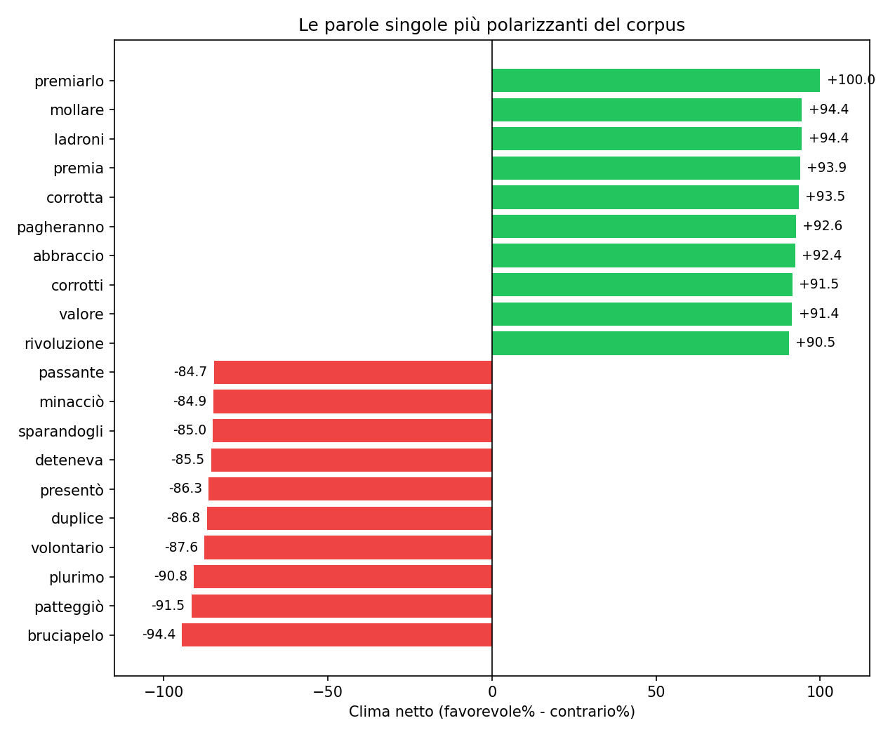

**Bigrammi e trigrammi.** Includere le frasi da due-tre parole rende il quadro ancora più netto, diverse arrivano al **97-100% di sbilanciamento** contro il 75-94% delle sole parole singole, ed emergono dettagli molto più specifici. Sul lato contrario emerge la dinamica esatta dei fatti, "colpire passanti" (il rischio per chi si trovava in strada), "fidanzato figlia pistola" (il precedente del 2005), "legittima difesa omicidio". Sul lato favorevole emergono accuse esplicite alle istituzioni e formule di elogio assolute, "giudici corrotti", "difendono delinquenti", "difendono criminali", "medaglia onore".

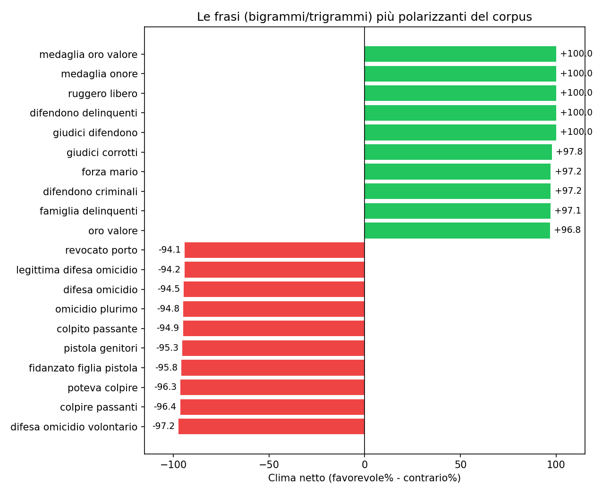

Questa differenza di registro si vede anche nella lunghezza dei commenti. Quelli **contrari sono quasi il doppio** dei favorevole, sia in caratteri che in parole.

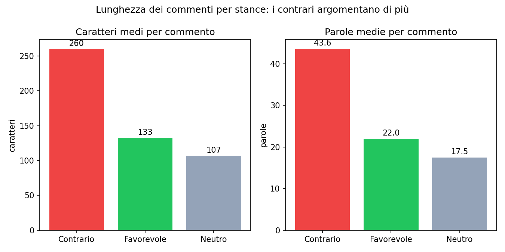

Chi difende la condanna tende a scrivere un piccolo ragionamento giuridico ("non era più legittima difesa perché il pericolo era cessato, quindi..."), chi la contesta tende più spesso allo slogan breve ("VERGOGNA", "medaglia al valore", "solidarietà"). È un dato di stile comunicativo consistente su tutto il corpus, non necessariamente un giudizio di qualità dell'argomento.

### I dieci commenti più popolari

Guardando ai commenti con più «mi piace», quelli con più consenso esplicito anziché i più numerosi, il segnale è ancora più netto. **Tutti e dieci sono favorevole a Roggero, nessuno contrario.**

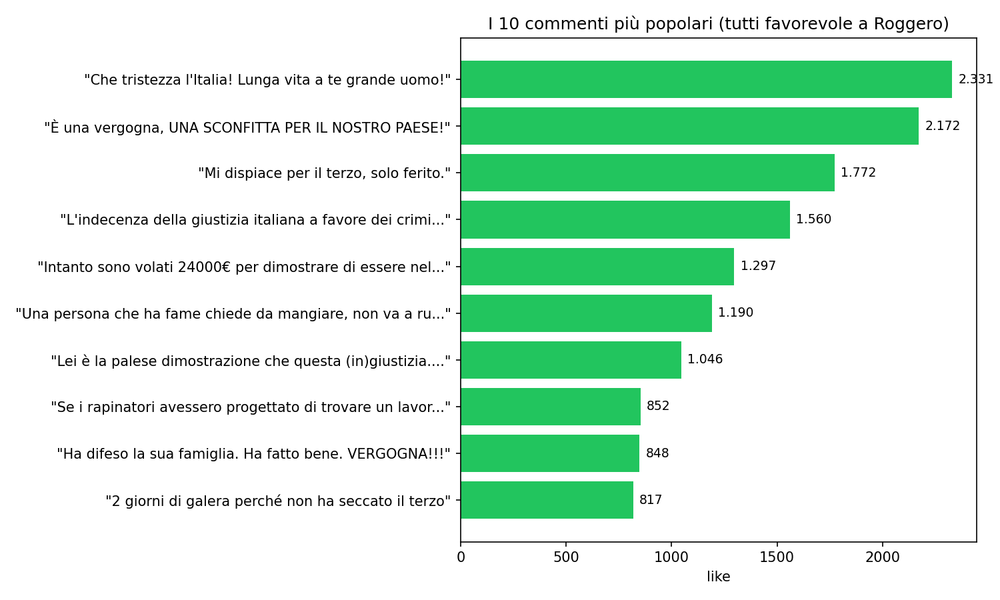

Il **100%** dei primi dieci commenti per popolarità è favorevole, contro il **62,7%** del corpus generale. L'engagement amplifica ulteriormente il sentiment già dominante, chi è d'accordo con Roggero scrive di più e riceve anche più approvazione sociale dagli altri utenti.

### Il clima per canale, anche i media mainstream sono favorevole

Invece di provare a etichettare la posizione politica del singolo utente con un modello (un esercizio tentato ma poi scartato per l'affidabilità non ancora sufficiente del modello disponibile), ho guardato un dato più solido, il **canale YouTube** sotto cui è stato pubblicato il commento. È un'informazione certa, non una previsione di un modello.

Il grafico mostra i **20 canali con più commenti**, i più influenti nel dibattito, non una selezione editoriale. La lunghezza della barra è il volume, il colore il clima (dal rosso contrario al verde favorevole).

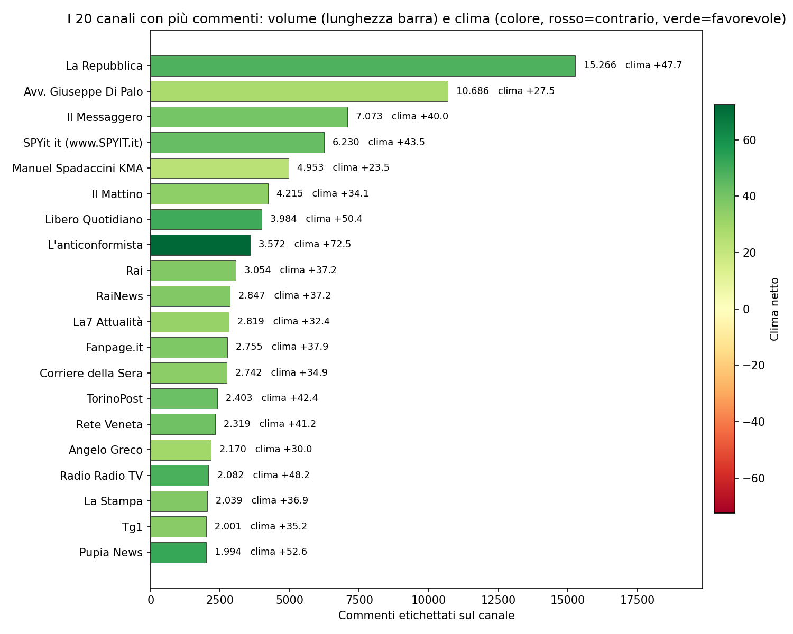

Il dato è netto, **tutti e 20 i canali con più volume sono in territorio favorevole**, dal verde chiaro (Manuel Spadaccini KMA, +23,5) al verde scuro (L'anticonformista, +72,5), e nessuno scende sotto lo zero. Ci sono grandi testate generaliste senza linea editoriale schierata sul caso (La Repubblica, Il Messaggero, Corriere della Sera, Rai, La7, Tg1, La Stampa) mescolate a canali di opinione dichiaratamente schierati, tutti nello stesso campo. È un **bias di piattaforma** diffuso su tutto lo spettro editoriale, concentrato proprio dove il dibattito è più grande, non l'effetto di una bolla di pochi canali di parte.

Con una soglia più bassa (almeno 50 commenti etichettati, 160 canali totali) i canali in territorio contrario salgono a **8**, ma restano tutti piccoli e vicini allo zero, nessuno supera le 720 commenti né scende sotto **-7,5**.

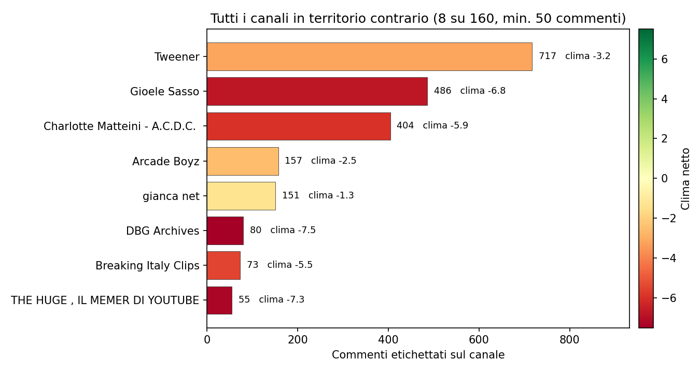

**Un controllo in più.** Cosa succede deduplicando anche qui per utente, un commento a testa per canale invece di tutti i commenti grezzi? Il pattern generale conferma quanto visto sopra sui contrari più prolifici, la maggior parte dei canali diventa ancora più favorevole dopo la deduplica (Rai +37,2 → +47,2, La7 +32,4 → +41,4, Il Mattino +34,1 → +42,2, TorinoPost +42,4 → +50,2). Canale per canale, i pochi contrario che commentano ripetutamente gonfiano leggermente il loro peso nei conteggi grezzi.

C'è però un'eccezione che vale la pena segnalare. **Gianca net** passa da un clima grezzo quasi neutro (-1,3, sembrerebbe un canale equilibrato) a **-15,2 dopo la deduplica**, una sproporzione di oltre **13 punti** nella direzione opposta a tutti gli altri. Il dato grezzo era gonfiato da un piccolo gruppo di utenti favorevole molto attivi (quasi 2 commenti a testa in media, il rapporto commenti/utenti più alto tra i canali medio-grandi). Il pubblico realmente distinto di quel canale (79 utenti unici) è più chiaramente schierato contro Roggero di quanto il conteggio grezzo suggerisse, un promemoria del perché conviene sempre controllare il dato deduplicato prima di fidarsi di un numero aggregato.

## Un giudizio già scritto

I dati raccontano una storia diversa da quella messa in scena dai leader politici nei giorni della sentenza definitiva. I talk show mostrano un centrodestra che difende Roggero e un centrosinistra che denuncia "sciacallaggio". I commenti YouTube mostrano **un giudizio pubblico enormemente sbilanciato a favore del gioielliere**, stabile dal 2023, presente su ogni canale che tratta il caso, comprese le testate senza alcuna linea editoriale sul tema.

Il quadro che emerge è **un consenso quasi unanime**, sei commenti su dieci favorevole contro poco più di due contrari, punteggiato da una minoranza più ostinata e più argomentativa. Chi contesta la sentenza scrive commenti più lunghi, usa un linguaggio più tecnico sulla dinamica dei fatti, e mantiene la propria posizione in modo più stabile nel tempo di quanto il volume complessivo lasci intuire.

Resta una domanda aperta, la stessa con cui si apre il racconto politico di questo articolo. **La richiesta di grazia è ancora sul tavolo di Mattarella.** Qualunque sarà la decisione, il pubblico di YouTube ha già scelto da che parte stare da tempo, e l'esplosione di luglio 2026 ha semplicemente alzato il volume di un giudizio formato molto prima.

Un'ultima avvertenza per leggere questi numeri con la cautela giusta. Chi commenta sotto un video YouTube è **un pubblico specifico**, più attivo online, e come mostrato più volte in questa analisi sistematicamente più favorevole a chi si è "fatto giustizia da solo" rispetto alla media del dibattito generale. Questi numeri misurano il sentiment di chi ha scelto di scrivere un commento, un campione parziale del dibattito pubblico, utile a leggerne la direzione e l'intensità, non un sondaggio rappresentativo del Paese.
