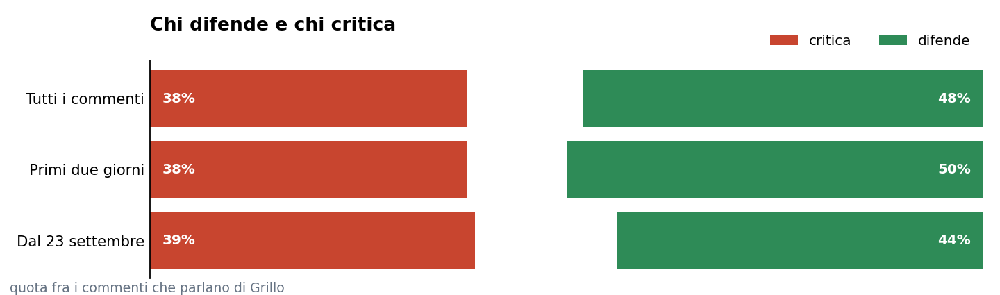
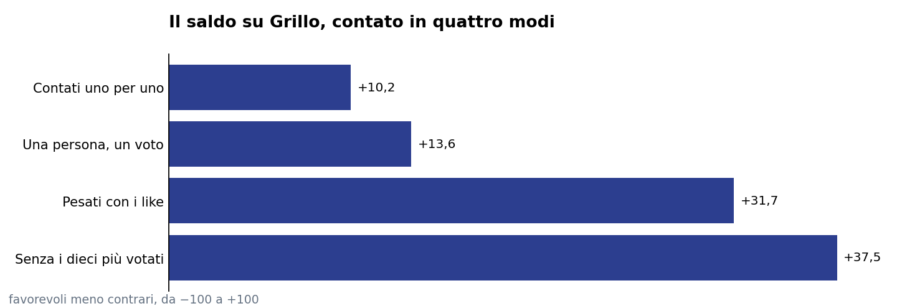
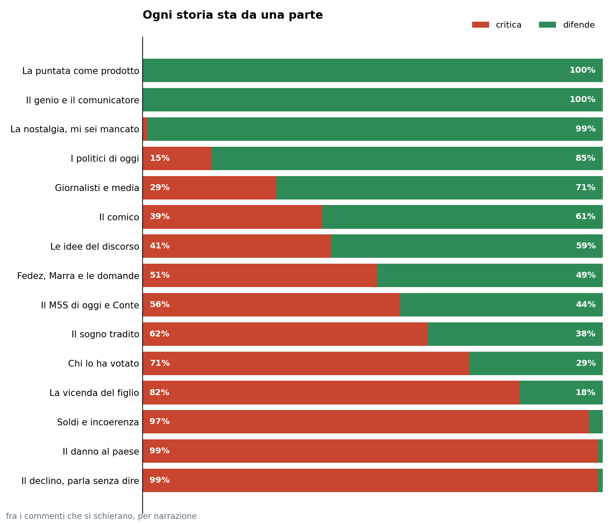
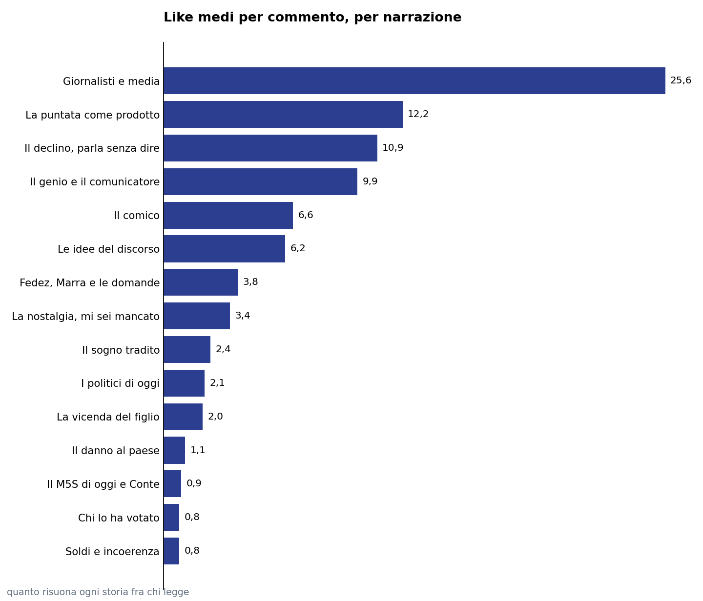

> Abbiamo contato tutti i 5.207 commenti sotto l'episodio. Chi scrive difende Grillo di poco, chi mette like lo difende molto di più.
> Pubblicato su [Popular Opinions](https://framik02.github.io/popular-opinions/grillo/) il 7 ottobre 2026.

# Grillo a Pulp Podcast, cosa dicono i commenti

**5.207** commenti contati · **4.088** persone · **+10,2** saldo su Grillo · **+31,7** pesato con i like

L'episodio 64 di Pulp Podcast è uscito il 21 settembre 2026, con **Beppe Grillo** ospite di Fedez e Mr. Marra per un'ora e venti. Al 7 ottobre sotto il video ci sono **5.207 commenti**, scritti da 4.088 persone diverse. Li abbiamo contati tutti, e per ciascuno abbiamo segnato se difende Grillo, se lo critica o se parla d'altro.

*Ogni commento è etichettato da Claude su una griglia scritta, la stessa per tutti i 5.207. Dati al 7 ottobre 2026.*

Più di un commento su tre non parla di lui. Parla della puntata, dei conduttori, dei giornalisti. Gli altri si dividono in due campi che raccontano due storie diverse, e che il pubblico silenzioso, quello che mette like senza scrivere, non tratta allo stesso modo.

*I like dei 3.796 commenti raccolti il 23 settembre sono quelli di quel giorno, quelli dei 1.411 successivi sono al 7 ottobre.*

## Il pubblico sta con Grillo, di poco

Dei 3.556 commenti che parlano di Grillo, **1.722 lo difendono e 1.361 lo criticano**. Il saldo, la quota dei favorevoli meno quella dei contrari, è **più 10,2**. Contando ogni persona una volta sola sale a più 13,6.

*Ogni commento è etichettato da Claude su una griglia scritta, la stessa per tutti i 5.207. Dati al 7 ottobre 2026.*

Chi è arrivato dopo è più critico. I 3.796 commenti dei primi due giorni davano più 12,4. I 1.411 scritti fra il 23 settembre e il 7 ottobre danno **più 5,2**.

*I like dei 3.796 commenti raccolti il 23 settembre sono quelli di quel giorno, quelli dei 1.411 successivi sono al 7 ottobre.*

## I like stanno da una parte

Il quadro cambia se si guarda chi legge senza scrivere. Un commento favorevole raccoglie in media **6,8 like**, uno contrario **3,2**. Pesando ogni commento con i suoi like il saldo passa da più 10,2 a **più 31,7**, e togliendo i dieci commenti più votati sale a più 37,5.

Eppure il commento più votato di tutti è contro. «Per i primi 12 minuti mi è sembrato di sentire mio zio ubriaco alla cena di Natale» ha **2.252 like**. Il più votato a favore ne ha 2.102: «Lo straniero non esiste. Esiste il povero. Anche da frasi così elementari e così spettacolarmente vere si capisce il genio di Beppe Grillo».

## Due campi, due storie

Oltre al giudizio, ogni commento racconta una storia. **Chi difende Grillo parla della persona**, del genio e del comunicatore in tre commenti favorevoli su dieci, della nostalgia in uno su sei. **Chi lo critica parla di come parla e di quello che ha fatto**, il declino in un commento contrario su quattro, i soldi e l'incoerenza in uno su cinque.

Quasi ogni storia sta tutta da una parte. Chi racconta Grillo come un genio non lo critica, chi lo racconta come un uomo in declino non lo difende. Fanno eccezione le storie della politica. Il sogno tradito, il Movimento di oggi e il comico dividono chi le racconta, perché chi rimpiange il Movimento dà la colpa ora a Grillo, ora a Conte, ora a Draghi.

## Lo scherno prende like, l'argomento no

In cima ai like ci sono i commenti sui giornalisti, **25,6 like** di media. Sono i saluti ironici ad Andrea Scanzi e le prese in giro della stampa tradizionale. Il declino è alto per un commento solo: senza lo zio ubriaco la media scende da 10,9 a 5,9.

In fondo c'è la critica argomentata. Soldi e incoerenza, chi lo ha votato, il Movimento di oggi e il danno al paese raccolgono **meno di un like e mezzo** per commento. Sono i commenti più circostanziati, e sono quelli che il pubblico premia meno.

## La storia politica resta aperta

Il nome più citato dopo quello di Grillo è **Giuseppe Conte**, in 133 commenti, spesso con un soprannome al posto del nome. Poi **Mario Draghi**, in 112, che torna soprattutto per l'ingresso del Movimento nel suo governo. Vannacci, Di Maio, Scanzi e Casaleggio stanno fra i 48 e i 60.

## Il figlio e le domande che non ci sono state

Grillo apre la puntata parlando del figlio e della sua condanna in primo grado. Il tema entra in **218 commenti** con un saldo di meno 50,3, fra i più negativi della conversazione, e solo 27 lo difendono. La critica ha due bersagli, Grillo che usa l'apertura per chiudere le domande scomode e i conduttori che non obiettano.

## Quello che il pubblico chiede

La richiesta più forte è una sola, **una rubrica fissa con Grillo**. I tre commenti che la chiedono in modo esplicito avevano insieme 2.298 like già al 23 settembre. Più del giudizio politico, i like premiano l'idea di rivederlo con regolarità.
