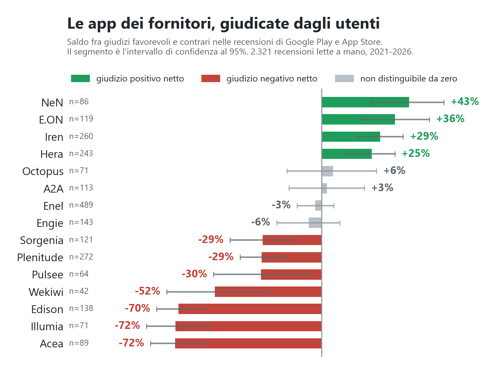
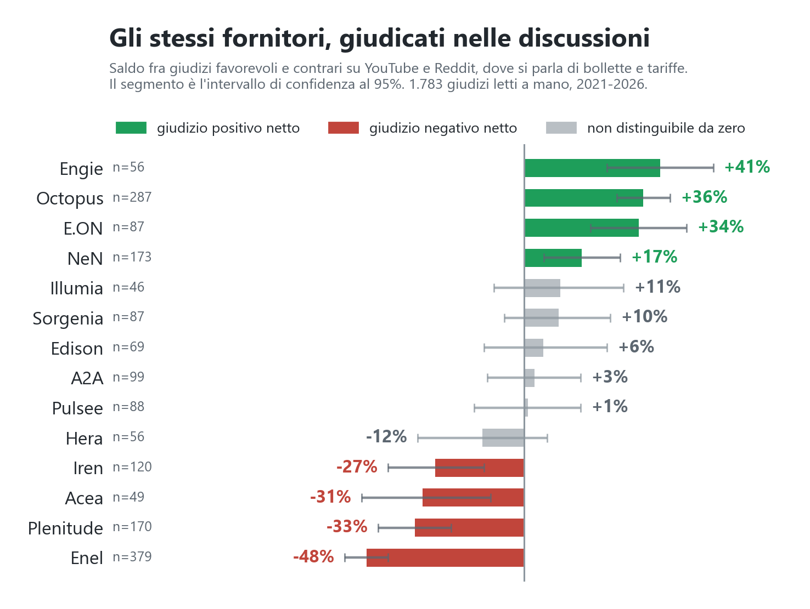
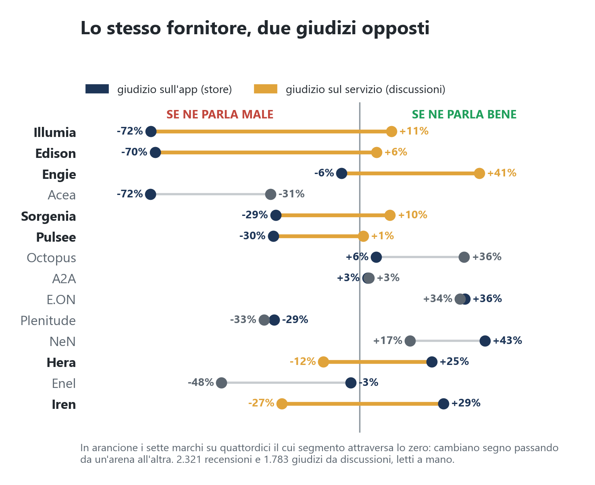
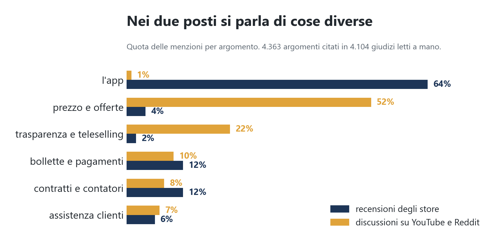
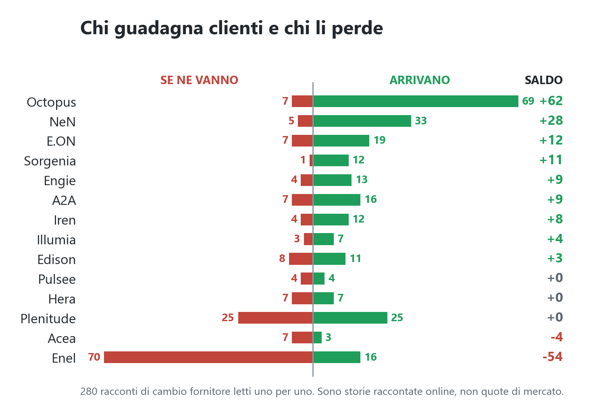
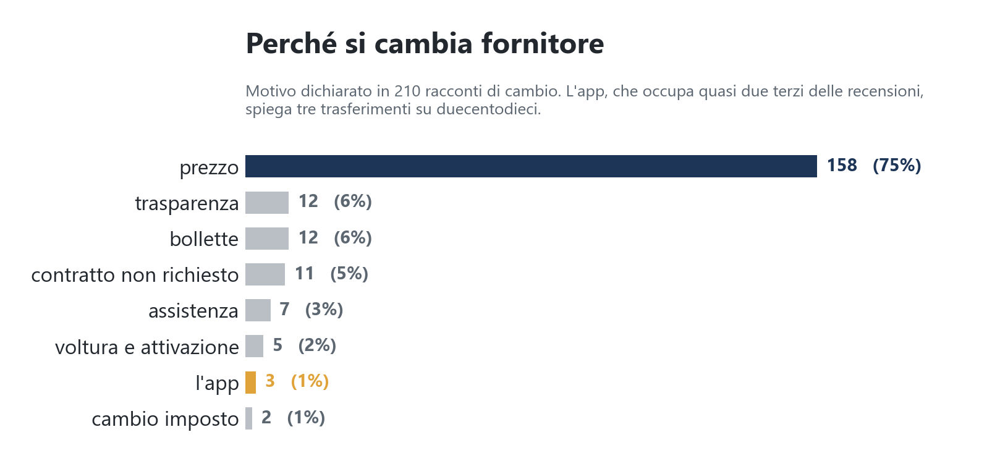

> Pubblicato su [Popular Opinions](https://framik02.github.io/popular-opinions/energia/) il 5 agosto 2026.
> 139.350 commenti e recensioni su undici fornitori di luce e gas, raccolti fra il 2021 e il 2026.

# Il tuo fornitore di luce è bravo o no? Dipende da dove lo chiedi

Cambiare fornitore di luce e gas è una di quelle cose che quasi tutti abbiamo fatto almeno una volta negli ultimi tre anni, spesso senza capirci molto. La fine del mercato tutelato ha spinto milioni di famiglie a scegliere, e per scegliere ci si informa dove capita, un video su YouTube, un thread su Reddit, le stelline sullo store.

Ho provato a mettere insieme quelle voci. Ho raccolto 139.350 commenti pubblicati fra il 2021 e il 2026 su Google Play, App Store, Reddit e YouTube, e ne ho letti e classificati a mano 4.104, uno per uno, indicando per ciascuno di quale fornitore parlasse e se ne parlasse bene o male.

Il risultato che non mi aspettavo è che non esiste una classifica sola. Ne esistono due, e per metà dei marchi dicono il contrario.

## Le due classifiche

Questa è la prima, quella che si ottiene leggendo le recensioni delle app sugli store. Il saldo netto è la differenza fra la quota di giudizi favorevoli e quella di giudizi contrari.

E questa è la seconda, quella che si ottiene leggendo le discussioni su YouTube e Reddit.

Illumia è penultima nella prima e quinta nella seconda. Edison è ultima nella prima e settima nella seconda. Iren è terza nella prima e quartultima nella seconda.

Non è un errore di misura. Sono due domande diverse a cui il pubblico risponde in due posti diversi.

## Lo stesso fornitore, giudicato in due arene

Ecco il confronto marchio per marchio.

**Sette marchi su quattordici cambiano segno.** Iren passa da +29% sull'app a −27% sul servizio, Enel da −3% a −47%, e all'opposto Illumia va da −72% a +11% ed Edison da −70% a +6%. Illumia ed Edison hanno due delle app peggio giudicate del campione e sono fra i fornitori di cui si parla meglio nelle discussioni. Iren e Hera hanno app apprezzate e vengono criticate quando si parla di bollette.

Su Enel e su A2A le due arene concordano, e su quei marchi il giudizio è più solido di tutti gli altri.

## Perché succede

La spiegazione è meno misteriosa di quanto sembri, e sta in cosa si scrive nei due posti.

Ho classificato ogni giudizio anche per argomento, undici categorie che vanno dal prezzo all'assistenza, dal teleselling alla lettura del contatore. Il confronto è netto.

Nelle recensioni degli store il **64%** delle menzioni riguarda l'app e appena il **4%** il prezzo. Nelle discussioni il **52%** riguarda il prezzo e l'**1%** l'app.

Una recensione sullo store si scrive dal telefono, subito dopo aver provato a fare una cosa che non funzionava. Una discussione su Reddit si apre quando si deve decidere se cambiare fornitore, e lì si confrontano centesimi al kilowattora e costi fissi annui. La lunghezza mediana passa da 73 caratteri a 241.

Quindi la classifica degli store misura la qualità del software, e questo spiega tutto il resto. Illumia ed Edison sono fornitori piccoli con app fatte male e prezzi competitivi. Iren e Hera sono multiutility con reparti informatici veri e tariffe che i clienti trovano care.

Per chi progetta questi prodotti la conseguenza è poco comoda. Il canale di feedback più rumoroso, quello che genera il maggior numero di recensioni e le stelline che tutti guardano, misura la variabile che meno c'entra con la ragione per cui si sceglie un fornitore.

## Dove vanno le persone quando cambiano

Nei testi che ho letto ci sono **280 racconti di cambio fornitore**, di cui 127 indicano sia da dove si veniva sia dove si è andati. Non sono quote di mercato, sono storie raccontate online, ma la direzione è chiarissima.

Octopus chiude con sessantanove arrivi e sette uscite, NeN con trentatré e cinque. Enel è l'origine di settanta racconti di uscita su duecentottanta. La rotta più battuta è Enel verso Octopus, quattordici racconti, seguita da Enel verso Plenitude, undici.

Plenitude è il caso più interessante. Chiude in pareggio esatto, venticinque arrivi e venticinque uscite. Raccoglie chi scappa da Enel e da Acea, e perde verso Octopus e NeN. È una tappa intermedia più che un capolinea.

Questo grafico e la classifica del servizio sono costruiti in modo indipendente, uno contando racconti di trasferimento e l'altra classificando giudizi, e danno lo stesso ordine. Quando due strumenti diversi puntano nella stessa direzione, il risultato regge.

## Si cambia per i soldi, e basta

Per ogni racconto di trasferimento ho registrato anche il motivo dichiarato, quando c'era. Sono 210.

Il prezzo spiega tre quarti dei cambi, centocinquantotto racconti su duecentodieci. L'app, che nelle recensioni degli store occupa quasi due terzi delle conversazioni, ne spiega tre su duecentodieci.

È lo stesso paradosso di prima visto dall'altro lato. Si parla di quello che si vede tutti i giorni, si cambia per quello che si paga.

## Il tema che non mi aspettavo di trovare

Sommando le menzioni di trasparenza e di contratti attivati con metodi discutibili si arriva al **22% delle discussioni**, secondo blocco tematico dopo il prezzo.

Non è un fenomeno aneddotico. Ricorre in cinque forme precise, e le ho ritrovate decine di volte.

C'è il contratto attivato senza che il cliente lo chiedesse. *"Un contadino di mia conoscenza gli hanno cambiato il gestore senza che avesse dato il suo consenso, si è ritrovato da Enel più conveniente lo hanno dirottato su A2A energia con un costo nettamente superiore."*

C'è la modifica unilaterale delle condizioni. *"Enel mi ha cambiato tacitamente contratto passando da 0,10 a 0,24."*

C'è la telefonata che usa il nome di un marchio noto senza appartenergli, con una formula che è lecita e che l'ascoltatore sente come se fosse l'azienda, chiamo **per conto di**. Il dubbio che ne segue è sempre lo stesso. *"Ma insomma, quindi in un certo senso è vero che è Enel che li manda? Io pensavo fosse un qualche operatore pincopallo."*

C'è il prezzo che in bolletta non corrisponde a quello promesso al telefono. E c'è la condizione scritta ma introvabile, che sotto il video promozionale di un fornitore diventa una domanda diretta. *"Più chiari di così cosa? Non dite nulla, mai pagato così caro."*

Il dato interessante è che nelle recensioni degli store questo tema vale il 2%. Chi ha subito un contratto non richiesto non lascia una stellina, apre un thread.

## Perché credere a questi numeri

Le due misure principali di questo lavoro sono indipendenti. La classifica dei giudizi viene da 4.104 testi letti e classificati uno per uno, i flussi di cambio fornitore da 280 racconti letti allo stesso modo. Non condividono nulla se non il corpus di partenza, e danno lo stesso ordine.

Ogni saldo che ho pubblicato ha il suo margine di errore calcolato. Su quattordici marchi, otto hanno un intervallo che non tocca lo zero e sei no. Di quei sei, Illumia, Sorgenia, Edison, A2A, Pulsee e Hera, la cosa onesta da dire è che il campione non basta a distinguerli da un giudizio neutro, e infatti l'ho detta.

Ho anche provato a fare quello che si fa di solito in questi casi, addestrare un modello sui testi già classificati e lasciargli classificare tutti gli altri. Sulle recensioni degli store funziona, arriva al 95% di accuratezza. Sulle discussioni no, e vale la pena spiegare perché.

Il modello sbaglia sistematicamente su frasi come *"Luce sei a 0,34 finito, con e.on saresti a 0,24"*. Per capire che è un elogio bisogna sapere che 0,24 è meno di 0,34 e che pagare meno è meglio. Non è una questione di vocabolario, è un confronto fra numeri con una conoscenza del settore. Ho provato dieci strade diverse, fra cui addestrarlo su centomila commenti del dominio e usarne uno cinque volte più grande, e nessuna ha risolto. Le discussioni le ho quindi lette a mano, tutte.

Un campione di 1.783 giudizi letti da una persona, con i margini di errore dichiarati, dice meno cose di trentaduemila predizioni automatiche. Le poche che dice però sono vere.

Durante il lavoro ho sbagliato, e sempre nello stesso modo. Misuravo l'accuratezza su un campione costruito in proporzione al corpus, che essendo per il 73% recensioni di store mi restituiva un numero unico e ottimo. Quello stesso numero, scomposto per fonte, valeva 0,93 sulle recensioni e 0,62 sulle discussioni. La media era corretta e non voleva dire niente.

## Cosa questi dati non dicono

Non dicono quale sia il fornitore più conveniente per voi, perché il prezzo dipende dai consumi, dalla zona e dal momento in cui si firma.

Non dicono quanti italiani hanno cambiato fornitore, perché l'unità di misura è il racconto e non la persona. Un saldo di meno cinquantaquattro per Enel significa che ci sono cinquantaquattro storie di uscita più che di entrata, nulla di più.

Non rappresentano tutti i clienti. Chi scrive online di bollette è più giovane e più informato della media, e chi apre un thread su Reddit per confrontare due tariffe non somiglia al correntista che paga da vent'anni senza guardare.

E soprattutto non dicono che Illumia sia meglio di Iren. Dicono che Illumia ha un'app peggiore e prezzi migliori, che Iren ha un'app migliore e prezzi peggiori, e che a seconda di dove si va a leggere se ne ricava una classifica opposta. Chi sceglie il fornitore guardando le stelline sta scegliendo un software.

Dati raccolti fra il 2021 e il 2026 su Google Play, App Store, Reddit e YouTube. Quindici fornitori: Enel, Plenitude, Octopus, Iren, NeN, Hera, A2A, Engie, Sorgenia, Edison, E.ON, Pulsee, Acea, Illumia, Wekiwi. Metodo, codice e insieme di verifica disponibili su richiesta.
