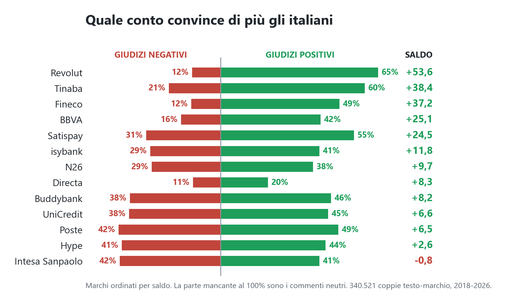
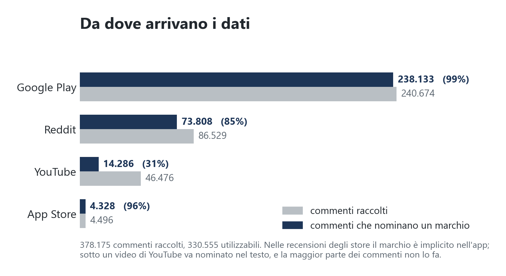
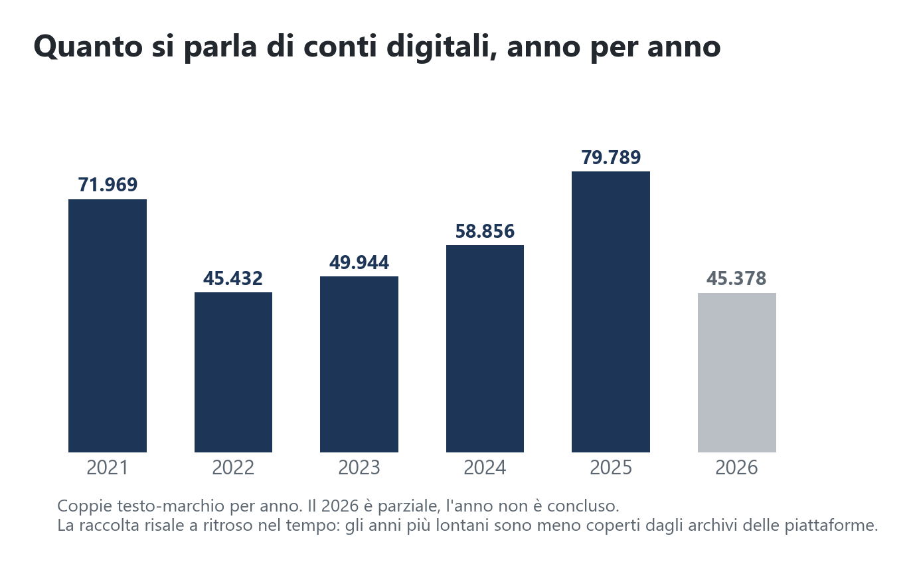
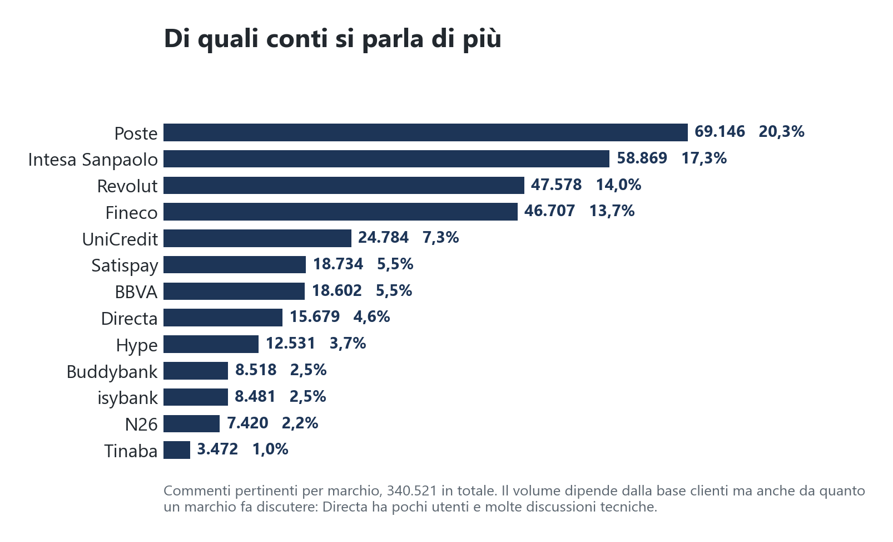
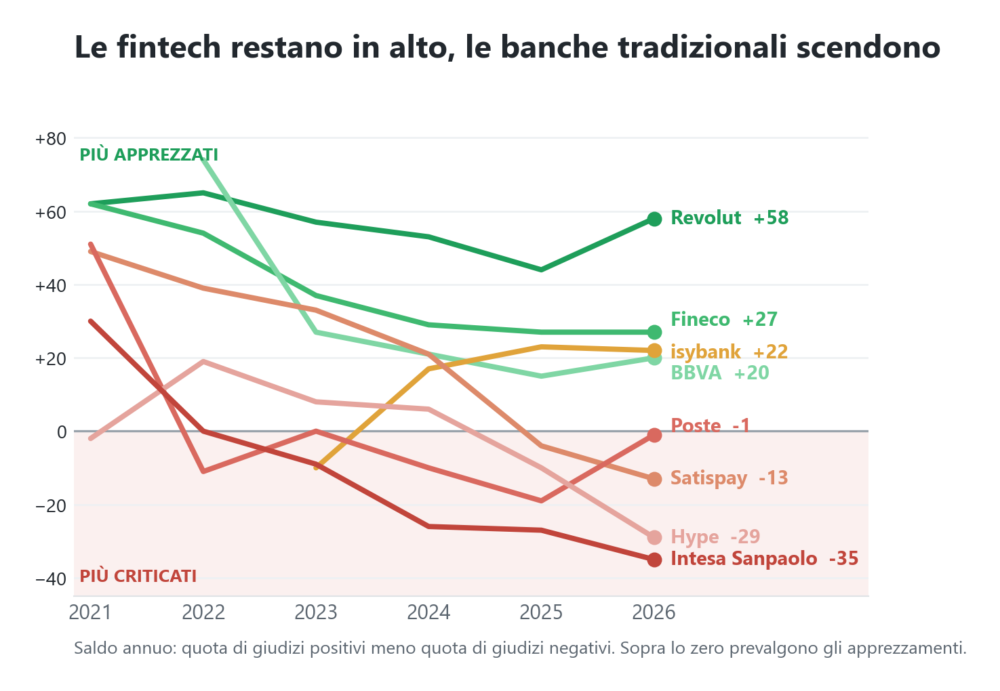
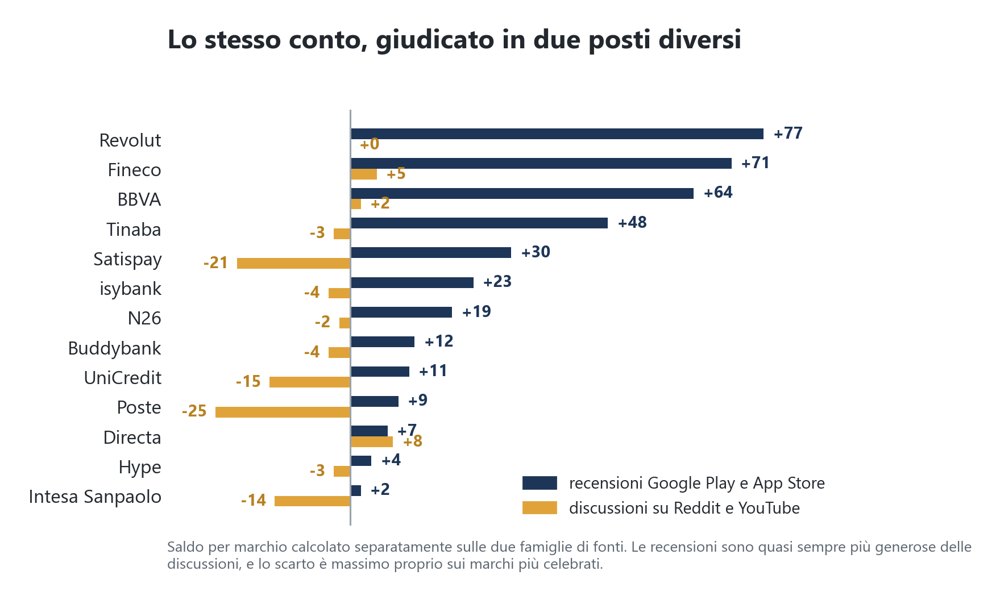
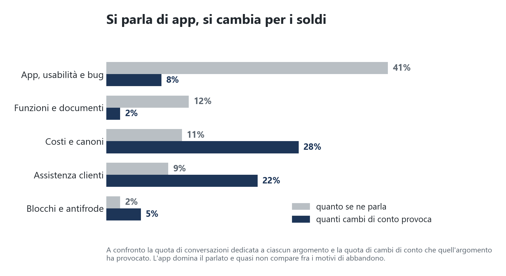
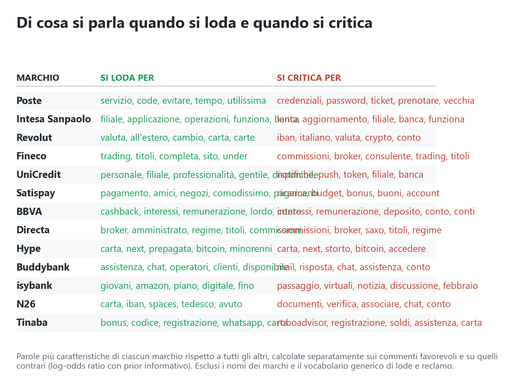
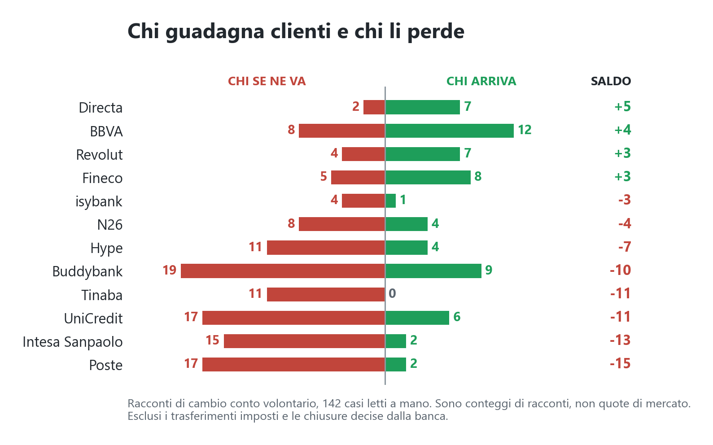

> Articolo di data journalism scritto per **Liberi Network**.
> Corpus di 330.555 commenti e recensioni raccolti fra il 2021 e il 2026 su YouTube, Google Play, App Store e Reddit.

# Quale conto convince di più gli italiani

Cambiare conto e assicurarsi di scegliere il migliore è una situazione in cui ognuno di noi si è trovato almeno una volta nella vita, e sappiamo bene che prima di farlo di solito ci informiamo online, chiediamo un parere alle persone di cui ci fidiamo e loro ci dispensano i loro preziosi consigli. Ma cosa succederebbe se questa domanda la ponessimo alla piazza digitale? Che cosa ci direbbe?

330.555 commenti dal 2021 a oggi risponderanno a questa domanda. Ci tengo a sottolineare che questa non è una classifica edulcorata o manipolata, ma l'onesta opinione pubblica ricavabile da fonti online. Quali? Lo vedrete più avanti nell'articolo. Intanto vediamo quali banche ho tracciato e come si posizionano.

## La classifica

In verde i giudizi positivi e in rosso quelli negativi. Il saldo netto è la differenza fra la quota di commenti favorevoli e quella di commenti contrari, e tiene conto dei marchi polarizzanti, quelli che raccolgono molti entusiasti e altrettanti detrattori.

Tre osservazioni prima di andare avanti.

Directa sta a metà classifica per un motivo che non ha a che fare con la qualità del servizio. Il 68,9% dei commenti che la riguardano sono neutri, la quota più alta di tutto il campione. Di un broker si parla in termini tecnici, si chiede quale ETF sia disponibile e quanto costi un eseguito, e i giudizi espliciti sono rari. Il suo 11,4% di critiche è il secondo più basso in assoluto, quindi il saldo modesto racconta il tono della conversazione e non l'insoddisfazione degli utenti.

Poste è il caso opposto. Ha solo il 9% di commenti neutri, la quota più bassa della classifica. Chi ne parla ha un'opinione e la esprime, in un senso o nell'altro, e le due fazioni sono quasi pari. È il marchio che divide di più gli italiani fra quelli osservati.

Intesa Sanpaolo è l'unica sotto lo zero. Su quasi 59.000 commenti raccoglie più critiche che apprezzamenti, e vedremo fra poco che il dato peggiora anno dopo anno.

## Da dove arrivano i dati

In blu i commenti in cui è riconducibile il marchio, in grigio i commenti totali raccolti.

Il dato che salta all'occhio è YouTube. Sono stati raccolti 46.476 commenti, ma solo 14.286 nominano un marchio, il 31%. La ragione è strutturale: sotto un video di finanza personale la maggior parte dei commenti riguarda il video, non una banca in particolare. Nelle recensioni degli store il marchio è invece implicito nell'app recensita, e la resa arriva al 99%. Il risultato è che YouTube pesa poco nei conteggi finali malgrado una raccolta consistente.

Le recensioni degli store dominano per volume e sono il materiale più povero. Sono brevi, spesso una riga, e fortemente polarizzate, perché una recensione si scrive quando si è molto contenti oppure molto arrabbiati. Reddit e YouTube pesano meno ma contengono le discussioni vere, quelle in cui un utente racconta di essere passato da una banca all'altra e un altro gli chiede come ha fatto e quanto ha pagato.

Questa differenza non è un dettaglio tecnico. Tenetela a mente, perché più avanti ribalta una parte della classifica.

## Quanto e di cosa si parla

Prima dei giudizi vale la pena guardare i volumi, perché dicono su quali marchi le conclusioni sono solide e su quali vanno prese con cautela.

Poste e Intesa Sanpaolo insieme valgono un terzo di tutto il materiale, il che è coerente con la loro base clienti. Tinaba ha 3.472 commenti, venti volte meno di Poste, e su di lei ogni conclusione va presa con la cautela che merita un campione piccolo. Directa è l'anomalia opposta: pochi utenti, molte discussioni tecniche, e finisce davanti a marchi assai più diffusi.

## Cinque anni di giudizi

Questo è il grafico che considero più significativo di tutta l'analisi. In alto chi convince, sotto lo zero chi delude.

Il saldo di Revolut resta sopra i cinquanta punti per tutto il periodo. Quello di Intesa Sanpaolo passa da +30 a −35, quello di Poste da +51 a −1.

La lettura ingenua sarebbe che le fintech piacciono sempre di più. I dati dicono un'altra cosa: le fintech stanno ferme e le banche tradizionali scivolano. Il vantaggio di Revolut nel 2026 è lo stesso del 2021, quello che è cambiato è il termine di paragone.

isybank fa il percorso inverso e merita un paragrafo suo. Compare nel 2023 a −10, l'unica partenza sotto zero di tutto il campione, e risale a +22 nel 2026. La partenza coincide con il trasferimento d'ufficio di centinaia di migliaia di clienti Intesa verso la nuova banca digitale, operazione poi bloccata dall'Antitrust perché avvenuta senza consenso esplicito. Passata l'ondata di indignazione il giudizio si normalizza: un marchio può nascere con la reputazione compromessa e recuperare in tre anni, ammesso che il prodotto funzioni.

Due crolli meritano attenzione. Satispay passa da +49 a −13 e Hype da +19 a −29. Sono le due discese più ripide del campione e in entrambi i casi coincidono con un peggioramento delle condizioni economiche: Satispay ha ridimensionato il sistema di cashback, Hype ha modificato i piani gratuiti. È lo stesso meccanismo che ritroveremo fra poco quando parleremo dei motivi di abbandono.

## Lo stesso conto, giudicato in due posti diversi

Vi avevo detto di tenere a mente la differenza fra le fonti. Ecco perché.

Ho ricalcolato il saldo di ogni marchio separatamente sulle recensioni degli store e sulle discussioni di Reddit e YouTube. È la cosa più sorprendente che ho trovato in tutta l'analisi.

Revolut ha un saldo di +77 nelle recensioni e di 0 nelle discussioni. Fineco passa da +71 a +5, BBVA da +64 a +2, Satispay da +30 a −21. Lo scarto è massimo proprio sui marchi più celebrati.

Due meccanismi lo spiegano, e vale la pena distinguerli.

Il primo è che le due arene contengono conversazioni diverse. Negli store il 60% dei commenti esprime un giudizio positivo e appena il 6% è neutro. Sui forum i neutri sono il 67%, perché lì si fanno domande, si confrontano commissioni, si chiede come si trasferisce un dossier titoli. La lunghezza media di un commento passa da 93 caratteri negli store a 331 sui forum. Non è lo stesso pubblico che parla in modo diverso, sono proprio due attività diverse.

Il secondo è più scomodo. Le recensioni a cinque stelle si sollecitano, e i conti digitali lo fanno sistematicamente: bonus di benvenuto, codici amico, premi per l'invito. Nel materiale che ho etichettato a mano il 3,4% delle coppie contiene un codice referral, concentrato proprio su isybank, Buddybank e BBVA. Sui forum quel meccanismo non funziona, anzi si rovescia, perché chi porta un codice viene spesso ripreso dagli altri utenti.

Chi resta in alto in entrambe le arene sono Fineco, BBVA e Directa. Chi resta in fondo in entrambe sono Poste, Intesa e UniCredit. Su questi sei marchi la classifica è solida. Su Revolut e Satispay il giudizio dipende molto da dove si guarda, ed è un limite che va dichiarato invece che nascosto.

## Si parla di app, si cambia per i soldi

Ho classificato ogni commento anche per argomento, undici categorie che vanno dai costi all'assistenza, dai blocchi antifrode alla facilità d'uso. E ho classificato separatamente 318 racconti di cambio conto, indicando per ciascuno il motivo dichiarato.

Il confronto fra le due liste è il risultato che mi ha convinto di più.

Quattro parole su dieci scritte sui conti digitali riguardano l'app. L'app provoca meno di un cambio di banca su dieci. Costi e assistenza insieme occupano un quinto delle conversazioni e causano metà dei trasferimenti.

L'interpretazione che mi convince è che l'app è ciò che si vede tutti i giorni e quindi è ciò di cui si parla, mentre i costi e il servizio clienti sono ciò che fa male e quindi è ciò per cui si agisce. Un'app scomoda irrita, un canone che aumenta o un'assistenza che non risponde quando hai il conto bloccato spinge a chiudere.

Per chi progetta questi prodotti la conseguenza è poco comoda: il canale di feedback più rumoroso, le recensioni degli store, misura la variabile meno correlata all'abbandono.

## Le parole di ciascun marchio

Ho estratto le parole più caratteristiche di ogni marchio rispetto a tutti gli altri, separatamente per i commenti favorevoli e per quelli contrari.

Un primo tentativo confrontava i favorevoli contro i contrari dello stesso marchio, e restituiva "ottima, semplice, intuitiva" per tutti e tredici: misurava il vocabolario della lode, che è identico ovunque e che sapevo già. Il confronto utile è fra marchi, dentro la stessa polarità.

Quattro cose che si leggono solo qui.

Revolut si loda per il cambio valuta e i viaggi, e si critica per l'IBAN lituano e i problemi con le domiciliazioni italiane. È lo stesso prodotto visto da due usi diversi: ottimo come conto da viaggio, problematico come conto principale.

BBVA compare con le stesse identiche parole da entrambi i lati, interessi e remunerazione. È il conto che vive di promozioni: attira per il rendimento e viene criticato quando il rendimento cala. Il ciclo si vede anche nel grafico temporale, dove BBVA scende da +74 nel 2022 a +20 nel 2026.

Buddybank è polarizzata sull'assistenza. La chat con gli operatori è la prima parola dei commenti positivi e compare anche fra i negativi, insieme a "mail" e "risposta". Chi la trova reattiva la elogia, chi resta senza risposta la abbandona, e nei flussi di cambio conto Buddybank ha diciannove uscite, il numero più alto di tutti.

isybank ha ancora "passaggio" fra le parole critiche, tre anni dopo la migrazione forzata. Il giudizio complessivo si è ripreso, la memoria dell'episodio no.

## Tre modi di perdere un cliente

Analizzando i 318 racconti di trasferimento mi sono accorto che metterli tutti nello stesso grafico sarebbe stato sbagliato, perché non sono la stessa cosa.

Il primo tipo è il cambio volontario, 142 casi. Una persona valuta, sceglie e si sposta.

Il secondo è il trasferimento imposto, e sono soprattutto i venticinque casi Intesa verso isybank. Il cliente non ha scelto niente, è stato spostato. Se questi finiscono nel grafico della concorrenza, isybank risulta un vincitore, quando in realtà ha quattro uscite volontarie contro una sola entrata volontaria. Ha ereditato clienti d'ufficio e ne sta perdendo di propri.

Il terzo tipo è l'espulsione, sedici casi, di cui undici riguardano N26 e tre Revolut. Qui è la banca che chiude il conto al cliente, in genere senza motivazione dettagliata e con i fondi congelati per settimane. Per N26 questo è il singolo fatto più citato dell'intero corpus. Non è concorrenza, è il contrario: un cliente che voleva restare e che è stato mandato via.

La maggior parte delle analisi commerciali sull'abbandono tratta questi tre casi come un fenomeno unico. Sono un quarto del totale e raccontano storie opposte.

Guardando solo i cambi volontari, il saldo fra chi arriva e chi se ne va è questo.

E questo è il percorso che quei clienti raccontano di aver fatto. Su 84 racconti in cui sia la banca di partenza sia quella di arrivo sono dichiarate, tre rotte si ripetono più delle altre.

**Da Directa a Fineco, 4 racconti.** Non è una fuga, è un travaso interno fra due broker: chi si sposta cerca in genere di avere conto corrente e conto titoli nello stesso posto, e Fineco offre entrambi. Sono gli unici due marchi del campione che si scambiano clienti in tutte e due le direzioni.

**Da N26 a Revolut, 4 racconti.** È la rotta più netta fra due fintech, e il motivo quasi sempre dichiarato è la chiusura del conto decisa dalla banca. N26 perde sette clienti in tutto e quattro finiscono da Revolut.

**Da Poste a BBVA e da Buddybank a BBVA, 3 racconti ciascuna.** Chi arriva a BBVA cerca il rendimento sul conto, ed è coerente con le parole che caratterizzano i commenti positivi su quel marchio: interessi, remunerazione, cashback.

Guardando dal lato di chi guadagna clienti, i tre marchi in attivo li prendono da posti diversi. **Fineco** raccoglie 13 arrivi, di cui 4 da Directa e 3 da Intesa: pesca sia fra i broker sia fra le banche tradizionali. **BBVA** ne raccoglie 13 distribuiti su sei origini diverse, il portafoglio più vario del campione. **Revolut** ne raccoglie 11 e sono quasi tutti fintech che perdono terreno: 4 da N26 e 3 da Hype.

Dal lato di chi li perde il quadro è più concentrato. **Intesa Sanpaolo** perde 14 clienti che si disperdono su sette destinazioni, senza un vincitore chiaro. **Poste** ne perde 13, e il primo destinatario è BBVA. **UniCredit** ne perde 8, di cui 2 verso Fineco e 2 verso N26.

Un dato va letto con attenzione: tre dei 14 clienti che lasciano Intesa vanno a isybank, che è la banca digitale di Intesa stessa. Nei racconti di questo gruppo il passaggio è volontario e motivato dai costi, quindi resta un cambio a tutti gli effetti, ma il cliente non esce dal gruppo. È la differenza fra perdere un cliente e spostarlo.

Sono conteggi di racconti, non quote di mercato. Un saldo di meno quindici per Poste significa che ci sono quindici volte più storie di uscita che di entrata, e nulla di più.

Tinaba è l'anomalia del dataset. Nella classifica di gradimento sta seconda con un saldo di +38, quindi chi la usa ne parla bene. Nei flussi ha undici uscite e zero entrate, l'unico marchio a quota zero. Non è un prodotto odiato, è un prodotto che le persone abbandonano senza rancore e verso cui nessuno si sposta.

## Perché credere a questi numeri

Le due misure principali di questo lavoro sono indipendenti. La classifica di gradimento viene da due modelli applicati a 340mila coppie di testo, i flussi di cambio conto da 318 racconti letti da un essere umano uno per uno. I due metodi non condividono niente se non il corpus di partenza, eppure danno lo stesso ordine: Poste, Intesa e UniCredit in fondo a entrambe le classifiche, Directa, Revolut, Fineco e BBVA in cima a entrambe. Quando due strumenti diversi puntano nella stessa direzione, il risultato si può pubblicare.

Detto questo, durante il lavoro ho sbagliato quattro volte e sempre nello stesso modo. Il campione con cui misuravo l'accuratezza non era rappresentativo e mi regalava cinque punti che non esistevano. Il filtro che scarta i commenti fuori tema sembrava intercettarne il 58% quando lo valutavo su dodici casi, ne intercetta il 42% valutato su cinquantadue. Avevo stimato al 3,1% i commenti non pertinenti, misurandoli sono il 6,7%. E il filtro per trovare i racconti di cambio conto, riscritto guardando i casi che sfuggivano, sembrava passare dal 33% al 59%: sulla metà di esempi che avevo tenuto nascosta fa 35%, e tutto il resto era memorizzazione.

La regola che ne ricavo è banale e me la sono dovuta imparare quattro volte: ogni volta che ho stimato invece di misurare ho sbagliato, e sempre nella direzione che mi faceva comodo.

## Cosa questi dati non dicono

Non dicono quale sia il conto migliore per voi, ma quale raccoglie più consenso fra chi ne scrive online, che è un gruppo particolare, mediamente più giovane e più interessato alla finanza personale del correntista medio. Non dicono quanti italiani hanno cambiato banca, perché l'unità di misura è il racconto e non la persona. E non dicono nulla su solidità, sicurezza o convenienza reale: un conto può essere molto amato e caro, oppure poco discusso e ottimo.

Quello che dicono, con ragionevole solidità, è che gli utenti italiani premiano le piattaforme digitali nate negli ultimi dieci anni, che il giudizio sulle banche tradizionali si deteriora a velocità costante da cinque anni, e che quando si arriva al momento di cambiare davvero, la cosa di cui tutti si lamentano non è quella che li fa muovere.

Dati raccolti fra il 2021 e il 2026 su Google Play, App Store, Reddit e YouTube. Metodo, codice e insieme di verifica sono disponibili su richiesta.
