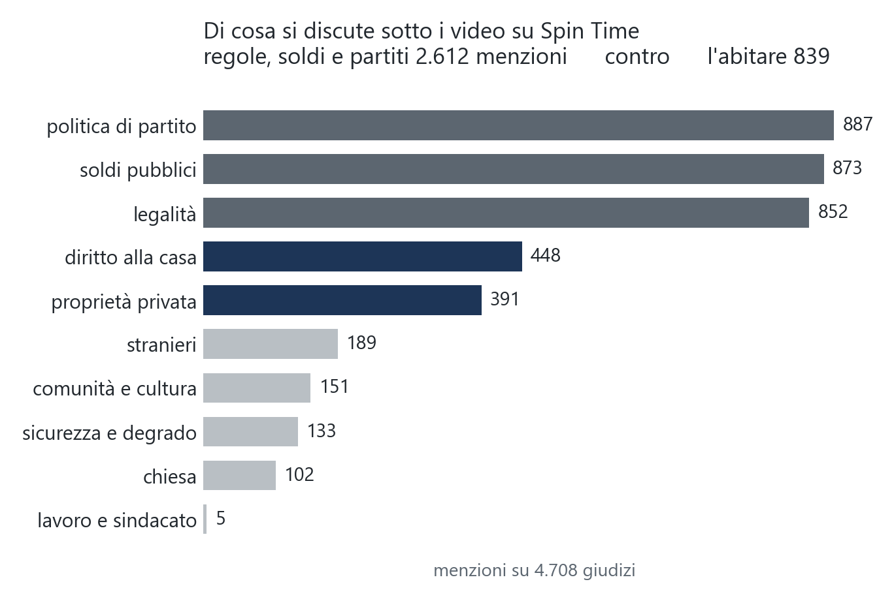
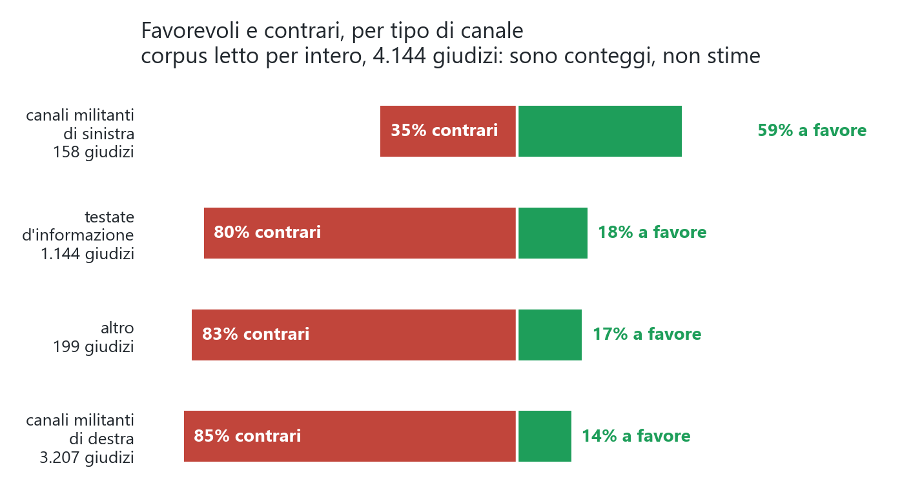
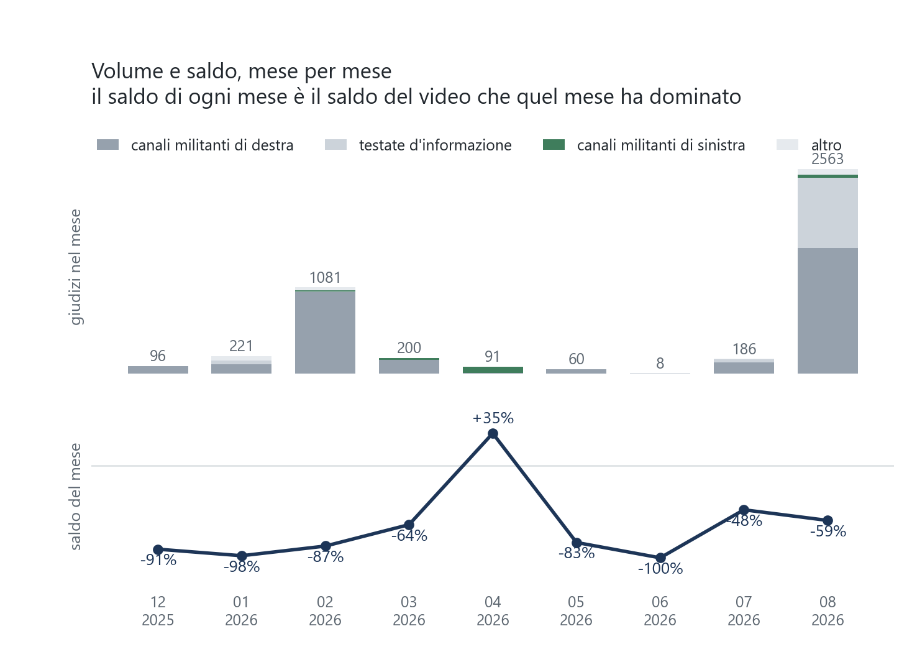
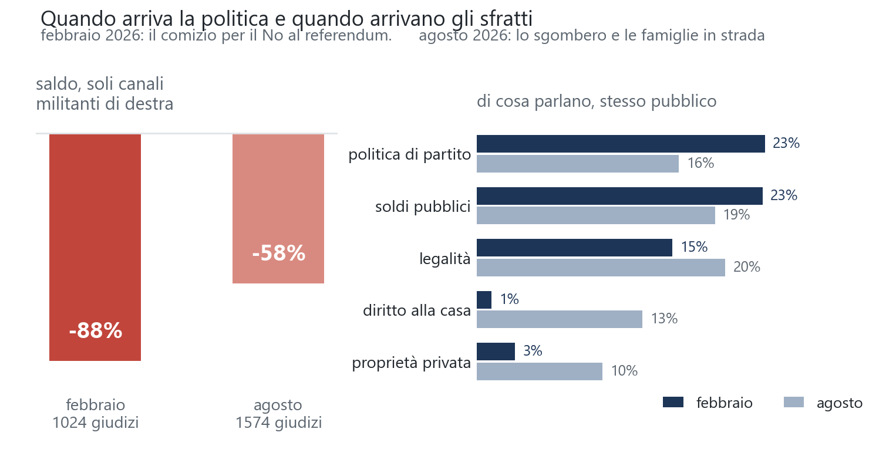
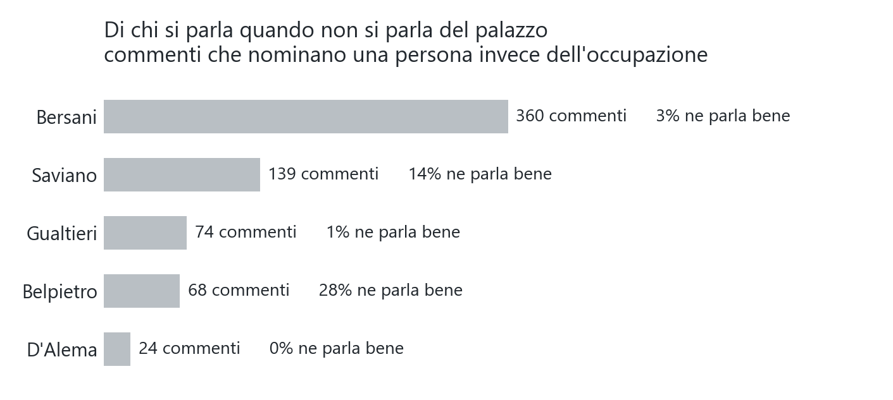
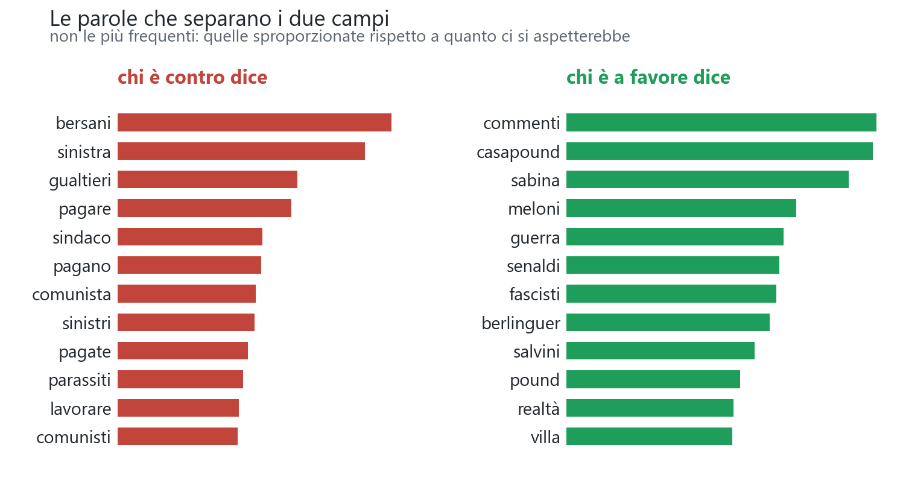

> Pubblicato su [Popular Opinions](https://framik02.github.io/popular-opinions/spin-time/) l'11 agosto 2026.
> Tutti i 6.114 commenti YouTube sul caso, letti e classificati uno per uno.

# Ho letto tutti i commenti YouTube sullo Spin Time. Quasi nessuno parla di case

Spin Time Labs è un palazzo di otto piani in via di Santa Croce in Gerusalemme, a Roma, occupato dal 2013 e abitato da qualche centinaio di persone. Nel 2019 ci andò l'elemosiniere del Papa a riattaccare la corrente tagliata per morosità, e da allora ogni volta che il posto torna in cronaca, per un incendio o un sequestro o uno sgombero annunciato, su YouTube si accende una discussione che dura giorni.

Ho preso quella discussione per intero, e intero va preso alla lettera. **Tutti i commenti che YouTube aveva sul tema la sera dell'11 agosto 2026, 6.114 sotto 126 video di 56 canali, letti e classificati uno per uno.** Non un campione, tutti. Per ciascuno ho indicato se parlasse davvero del caso e, se sì, se stesse dalla parte degli occupanti o contro.

Mi aspettavo di trovare una lite sul diritto alla casa. Ho trovato altro.

## Di cosa si parla, davvero

Dei 6.114 commenti, **4.708 riguardano il caso**, il 77%. Gli altri sono risse di partito senza alcun riferimento all'occupazione, o discussioni finite lì per caso. Su quei 4.708 ho segnato anche gli argomenti.

Messa in un altro modo, gli argomenti che riguardano le regole, i soldi e i partiti valgono **2.612 menzioni**; quelli che riguardano l'abitare, diritto alla casa e proprietà messi insieme, ne valgono **839**. Per ogni commento che discute di chi debba stare in una casa ce ne sono tre che discutono di chi paga la bolletta e di chi ha la tessera giusta.

Non è che il tema della casa manchi. È che perde. La domanda che il pubblico si fa davanti a un palazzo occupato non è dove dovrebbero andare quelle persone, è perché loro non pagano e io sì.

## Chi parla, e da dove

Su 4.708 giudizi, **sei** vengono da qualcuno che dice di conoscere il posto di persona, quattro che ci sono stati dentro, due che abitano lì vicino.

Sei su 4708.

È il numero che mi ha colpito di più. Una discussione lunga anni, decine di migliaia di parole scritte, e praticamente nessuno di quelli che scrivono è mai entrato nell'edificio di cui scrive. Quasi tutti parlano di quelle persone. Quasi nessuno è quelle persone.

Visto che sono sei, li ho riletti tutti. **Non sono d'accordo fra loro.** Tre stanno contro, due a favore, uno resta in mezzo.

> «Umana? Ci ho passato 10 anni in quella merda e non è umana. Lascia traumi indelebili»

> «Io ci abito e ne vado fiero»

> «Sono operaio anch'io, che cazzo c'entra. Parlo delle tende della gente in strada, della via chiusa. Ci sei mai passato davanti?»

> «Ci sono stato, non ho visto tutte queste cose, non escludo vi siano. Comunque rimane una cosa: perché non pagate e occupate?»

Il quinto è il più lungo di tutti e ricostruisce vent'anni di quartiere. Abita a trecento metri dal 1995, racconta che quando l'immobile fu ceduto al fondo nel 2004 la zona diventò «un muro di serrande chiuse», e sostiene che Spin Time l'abbia riattivata mentre l'ennesimo albergo di pregio non aiuterebbe il commercio di prossimità. Il sesto racconta di essere stato pagato per fare teatro lì dentro, con fondi Caritas, e poi si lamenta degli attori che «cercano il brivido delle luci della ribalta».

Quasi cinquemila persone sanno con certezza cosa sia quel posto. Le sei che ci sono state hanno opinioni diverse, e nessuna delle sei lo dice con la sicurezza delle altre.

## Il conto finale

**3.857 contrari, 778 favorevoli, 73 neutri. Saldo −65%.**

## Tre bolle, e non dicono la stessa cosa

Ho diviso i commenti per **arena**, cioè per il tipo di canale sotto cui sono stati scritti.

Che i canali militanti si dividano non stupisce nessuno. Il numero che vale la pena guardare è quello di mezzo. **Sotto i video delle testate d'informazione il saldo è −62%**, a undici punti da quello dei canali apertamente schierati contro.

Lo spazio dei commenti di un telegiornale non è terreno neutro dove le posizioni si incontrano. È un posto dove una parte sola si presenta.

C'è anche una ragione di volume, e va detta. Il 67% di tutti i commenti del corpus sta sotto canali militanti di destra. I due video più commentati in assoluto sono uno sull'intervento di Saviano, 561 commenti, e uno sul comizio di Bersani, 527. Questa discussione non si è svolta in un posto neutro con qualche estremista ai bordi. Si è svolta quasi tutta in casa di una parte.

## Due picchi, e due discussioni diverse

Questa è la discussione mese per mese, il volume sopra e il saldo sotto.

La prima cosa da dire è che una serie storica, qui, non esiste davvero. I commenti coprono sette anni ma **il 92% è stato scritto negli ultimi nove mesi**, e ventotto mesi su quarantasei ne hanno meno di dieci. Non c'è un andamento da leggere. Ci sono due picchi che da soli fanno il **74% di tutto il corpus**, e in mezzo il rumore.

**Febbraio 2026, 1.281 commenti.** Il 22 febbraio D'Alema, Speranza e Bersani vanno a Spin Time a tenere un comizio per il No al referendum sulla separazione delle carriere, che si vota un mese dopo. La reazione arriva quasi tutta da canali militanti di destra, compreso quello ufficiale di Fratelli d'Italia, che da solo raccoglie 527 commenti. Il video più commentato si intitola «Bufera su Bersani per il comizio per il No al centro sociale Spin Time».

**Agosto 2026, 3.243 commenti.** Lo sgombero è avvenuto e le persone dormono per strada, con il caldo. I titoli dei video di quei giorni dicono tutto. Gli sfollati dormono in strada, malori per le alte temperature, la proprietà rifiuta di vendere al Comune, quattrocento persone vivono in strada. Arrivano Saviano, Zerocalcare, una cantante che fa un concerto fra le tende, il sindaco. Qui per la prima volta le testate d'informazione contano davvero, il 35% dei commenti del mese.

Il saldo dei due picchi è molto diverso, **−87% a febbraio e −59% ad agosto.** La spiegazione comoda sarebbe la composizione, visto che ad agosto entrano le testate, che sono meno ostili dei canali militanti.

Non regge.

**Dentro i soli canali militanti di destra**, febbraio fa −88% e agosto −58%. Stesso tipo di canale, stesso pubblico, trenta punti di differenza. E ripesando agosto con la composizione di febbraio il saldo non si muove, quindi la composizione non spiega niente.

Quello che cambia è di cosa si parla. A febbraio il **64%** dei commenti di quell'arena attacca una persona invece del palazzo, e il diritto alla casa compare nell'**1%** dei giudizi. Ad agosto gli attacchi personali scendono al 27%, il diritto alla casa sale al 13%, la proprietà privata dal 3% al 10%.

Detto in modo compatto, **quando la politica entra nel palazzo si parla di politici, quando le persone finiscono in strada si parla di case.** E lo stesso pubblico, sugli stessi canali, diventa di trenta punti meno ostile.

Una precisazione sul grafico qui sopra, perché è il tipo di cosa che si legge male. La linea del saldo mese per mese sembra un'opinione che oscilla di centotrenta punti fra gennaio e aprile. Non lo è. Ogni mese è dominato da un video solo e il saldo del mese è il saldo di quel video. Ad aprile l'88% dei commenti sta sotto un documentario di un canale di sinistra, ed è l'unica barra verde. Su un corpus fatto così una serie storica misura la programmazione editoriale di YouTube.

## L'insulto per interposta persona

Leggendo mi sono accorto presto che una fetta grossa dei commenti non parla dell'occupazione. Parla di Saviano, che ci è andato a fare un intervento; di Bersani, che ci ha tenuto un comizio; di D'Alema, di Zerocalcare, di Ken Loach, del cardinale Krajewski. E dall'altra parte del giornalista che li attacca in studio, o del sindaco di Roma.

«Torna nel tuo attico di New York» non contiene una sola parola sul palazzo. Ma sta sotto un video sul palazzo, ed è chiaro a tutti da che parte stia chi lo scrive.

Ho deciso di contarli come giudizi, marcandoli con una bandierina apposta perché ogni classifica si potesse calcolare due volte. Sono **1.732 su 4.708, il 37%**.

Contarli o no cambia poco quasi ovunque. Militante di destra passa da −71% a −63%, informazione da −62% a −64%. Ma nell'arena di sinistra il saldo crolla **da +24% a +2%**.

Il motivo è che quel bacino è quasi tutto costruito attorno a un documentario, e sotto un documentario si ringrazia la regista. Senza quella bandierina avrei pubblicato la popolarità di un film spacciandola per consenso verso un'occupazione.

## Il favorevole non esiste come posizione autonoma

Questa è la cosa che ho capito solo leggendo tutto, e che un campione mi aveva nascosto.

Dei 778 giudizi favorevoli, **217 sono per delega**, cioè difendono Saviano o attaccano il giornalista senza dire niente del palazzo. Altri **118 usano la formula «e allora CasaPound?»**, su cui torno fra poco, che non è sostegno all'occupazione. Restano 456 giudizi che difendono direttamente, di cui 164 parlano di diritto alla casa.

Nella parte più ostile del corpus il rapporto è ancora più netto. Nei primi trecento commenti letti sotto i video sul comizio di Bersani ho trovato 36 favorevoli. Ventisei erano per delega, dodici erano «e allora CasaPound», e **nessuno era un giudizio diretto e argomentato a favore**.

Chi difende Spin Time in quegli spazi non dice «hanno ragione». Dice «e voi allora».

I 456 che invece dicono qualcosa in proprio suonano così. «Si combattono i poveri, non la povertà»; «è una follia vedere famiglie che non riescono a campare in modo dignitoso, altro che occupare»; «la casa è un diritto». Ci sono, si contano, e più della metà sta sotto quattro video soli.

## Chi si insulta al posto del palazzo

I 1.732 giudizi per delega non sono distribuiti a caso. Contando solo quelli che fanno un nome esplicito, e sono un minimo garantito perché moltissimi dicono soltanto «questo» o «sto tizio».

Bersani da solo raccoglie **360 commenti** e il 3% ne parla bene. D'Alema ne raccoglie 24 e nessuno ne parla bene. Una persona passata di lì una volta a fare un intervento raccoglie quasi tanti commenti quanto l'intero argomento «diritto alla casa», che ne ha 448.

C'è però un'asimmetria interessante nella colonna di destra. Belpietro, il giornalista che il caso lo attacca, raccoglie 68 commenti e il **28%** ne parla bene. È il doppio della quota di Saviano e nove volte quella di Bersani. Detto altrimenti, nella parte ostile del corpus una minoranza esiste, ma si esprime attaccando chi conduce, non difendendo chi è sgomberato.

## Come si litiga

Le bandierine sul registro raccontano il tono meglio di qualsiasi percentuale. **Millecinquecentosessantotto insulti** su 4.708 giudizi, e 1.539 giudizi che non contengono alcun argomento.

Un giudizio su tre è un insulto. Fra i soli contrari la quota è il 37%. «Zecche», «parassiti», «drogati», «andate a lavorare», ripetuto centinaia di volte con minime variazioni. Dall'altra parte «fascisti» e «ignoranti», meno numerosi solo perché quella parte è più piccola.

E **1.539 giudizi su 4.708, il 33%, non contengono alcun argomento**. Non dicono perché, dicono soltanto contro chi.

Un'ultima cosa che si vede solo mettendo le due parti a confronto. I giudizi favorevoli sono **più lunghi** di quelli contrari, 91 caratteri mediani contro 73, e insultano molto meno, il 16% contro il 37%. Ha una spiegazione poco consolante. Per stare contro basta una parola, «parassiti», e chi legge capisce subito. Per stare a favore bisogna spiegare, e in quella sezione commenti spiegare costa.

## Le parole che separano i due campi

Ho cercato le parole sproporzionate, non le più frequenti. Le più frequenti sono le stesse per tutti («casa», «non», «che») e non dicono niente. Queste sono quelle che compaiono in un campo molto più di quanto ci si aspetterebbe dalla loro frequenza complessiva.

A destra e a sinistra si vede la stessa cosa, ed è quasi comica. **Nessuno dei due campi parla del palazzo, tutti e due parlano dell'avversario.**

Chi è contro dice bersani, sinistra, gualtieri, sindaco, comunista, sinistri. Chi è a favore dice casapound, meloni, salvini, fascisti, senaldi, belpietro. Le uniche parole di contenuto vero sono nella colonna rossa e sono sempre la stessa, **pagare, pagano, pagate, paga**, quattro forme dello stesso verbo, insieme ad affitto. Nella colonna verde l'unica parola di contenuto è «comunità».

Due parole meritano una nota. «Sabina» è Sabina Guzzanti, che ha girato un documentario sul posto, e conferma quello che si vedeva già nell'arena militante di sinistra, cioè che quel bacino è in buona parte il pubblico di un film. «Commenti» è più curiosa, perché è la parola più tipica in assoluto dei favorevoli. Sono le persone che, invece di parlare dell'occupazione, commentano gli altri commenti. «Guardate che commenti genera questo video».

## CasaPound, la parola che rovescia tutto

CasaPound è la sede occupata da un movimento di estrema destra a Roma, in un immobile dello Stato, dal 2003. Nel corpus **155 commenti la nominano**, il 2,5% del totale. Sono pochi, e sono i più interessanti che ho letto.

Il corpus intero sta a −65%. **I commenti che nominano CasaPound stanno a +22%**, con il 61% di favorevoli. Ottantasette punti di scarto.

E il ribaltamento non è dovuto a chi li scrive. Sui canali militanti di destra, dove i favorevoli sono in media il 14%, **fra i commenti che nominano CasaPound sono il 63%**. La stessa arena, la stessa settimana, e nominare quel posto cambia il segno.

Il motivo è che la frase non difende Spin Time, accusa chi lo attacca. «E allora CasaPound quando la sgomberano?», «due pesi e due misure», «anche CasaPound deve pagare». È un'accusa di doppio standard, e funziona come un grimaldello. Chi la usa non deve dire niente sull'occupazione, gli basta indicare l'altra.

**Un favorevole su otto di tutto il corpus è di questa forma.** Novantatré su 778.

C'è anche il movimento speculare, e l'ho trovato solo leggendo tutto. Nei video contro il sindaco la stessa frase compare rovesciata, usata da chi sta contro. «Se dai le case a loro dalle anche a CasaPound», «casapound è in uno stabile dello Stato e come questo ce ne sono moltissimi altri, ovviamente tutti dovranno essere sgomberati». Cinquantanove commenti su 152. Stesse parole, direzione opposta, e a distinguerle serve sapere sotto quale video sono state scritte.

## Cosa ho fatto e cosa non ho fatto

Ho raccolto i commenti con l'API pubblica di YouTube e li ho letti a mano, tutti, con un codebook scritto prima e corretto tre volte durante il lavoro. Ogni correzione è versionata, così si può risalire a quali giudizi sono stati dati con quale regola.

Ho anche provato a far fare il lavoro a un modello automatico. Sul campione di prova arriva all'81% di risposte giuste, ma una macchina che rispondesse sempre «contrario» ne farebbe giuste il 79%. Su un corpus letto per intero un modello del genere non serve a niente. **I numeri di questo articolo sono conteggi, non predizioni.**

C'è un caso che spiega bene perché la macchina fatica. La frase «e allora CasaPound?» compare con il segno rovesciato a seconda di dove sta. Sotto un video di sinistra è una difesa dell'occupazione, sotto un video che attacca il sindaco è un modo per attaccarlo ancora («se dai le case a loro dalle anche a CasaPound»). Stesse parole, direzione opposta, e si distingue solo sapendo sotto cosa è stata scritta.

Infine, questi non sono gli italiani. Sono le persone che commentano sotto un video di YouTube, che è un pubblico particolare e più arrabbiato della media, e che in questo caso specifico si è radunato per tre quarti in casa di una parte politica. Il dato non dice cosa pensa Roma dello Spin Time. Dice cosa succede quando lo Spin Time finisce in una sezione commenti. E quello, di questi tempi, è già un posto dove si decidono parecchie cose.
